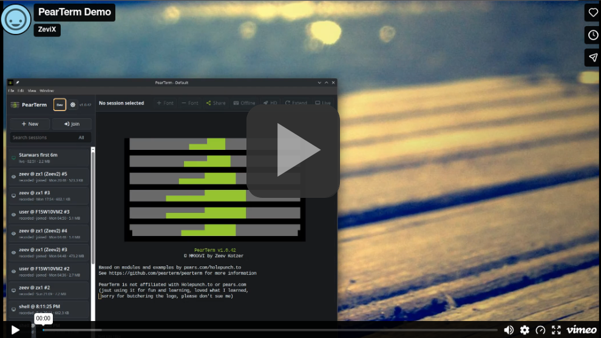

<p align="center">
  
</p>
<h1 align="center">ZBTerm</h1>
<h3 align="center">Secure terminal recording, playback and peer-to-peer sharing</h3>
<h3 align="center">over Pear (Hyperswarm) or Freenet, built on Electron and Bare</h3>

<p align="center">
  <a href="https://vimeo.com/1209702239">
  
  </a>
</p>


## Highlights
- Interactive PTY-backed shells, with encrypted terminal output recorded to a
  local session catalog and played back with a scrubber.
- Peer-to-peer live sharing of a running terminal (host and one or more
  viewers) over two networks: Pear (Hyperswarm), with optional relay fallback
  for NAT traversal, and, experimentally, [Freenet](#freenet). Each share picks
  its network, and Pear and Freenet shares can run at the same time.
- Per-link permission caps, host approval, keyboard sharing and key rotation.
- A localhost REST API for debugging and automation.

ZBTerm uses [Hypercore](https://docs.pears.com/reference/building-blocks/hypercore/)/[Hyperbee](https://docs.pears.com/reference/building-blocks/hyperbee/) for encrypted session history
storage and [Hyperswarm](https://docs.pears.com/reference/building-blocks/hyperswarm/) for real-time peer-to-peer communication,
demonstrating the power, extreme performance, simplicity and versatility of
the Pear/Bare platform. The core runs in a [Bare](https://github.com/holepunchto/bare)
worker, separate from the Electron shell. Identity and the Freenet transport
run in `zxterm-core`, a Rust sidecar built from the
[zevix/zxterm](https://github.com/zevix/zxterm) submodule.

Note: ZBTerm is not affiliated with Holepunch.to or pears.com

New here? [**The tour**](docs/OVERVIEW.md) covers every feature and key
binding, and `./demo.sh` ([docs/demo.md](docs/demo.md)) walks the real app
through them on scratch data.

For detailed architecture see [docs/ARCHITECTURE.md](docs/ARCHITECTURE.md)

## Current version status

### Implemented
- Multiple profiles for sharing on the same machine (great for testing)
- Multiple active sessions that can be switched between
- Single-user invitation key (no approval required)
- Multi-user invitation key (approval required; no real guarantee of viewer identity)
- Keyboard sharing for all users — off by default, toggleable by the host
- Time slider with activity indicators for going back in time; its bubble shows
  the wall-clock time beside the elapsed time (`14:32:05` today, `Thu 14:32:05`
  within the week, the full date otherwise)
- Compressed time: idle stretches longer than the threshold (2 s by default)
  count for the threshold only, on the slider, in the time labels and in
  playback, which keeps moving through them. Hover the time label for the
  uncompressed time. Alt+wheel steps frame by frame and, like the plain wheel,
  returns to live past the last frame of a running session
- Selecting text in history keeps the selection; starting a drag while playing
  pauses playback, and the play button blinks a caret until it resumes. A
  right-click keeps the selection, so the menu's Copy copies it
- Collapsible side pane: click the ZBTerm logo (a hamburger on hover) or press
  Ctrl+Shift+B. While it is collapsed, the top bar holds the logo, New, Join
  and Settings, and Identity and Dark theme move into the settings menu. The
  choice survives a restart
- One search box, at the bottom left of the window, the status text to its
  right; Ctrl+Shift+F focuses it (it is never sent to the program in the
  terminal, and does nothing while a dialog is open). Its text filters the
  session list by name and highlights every match in the selected session's
  buffer, scrollback and full-screen programs included (past 2000 matching
  rows, those within three screens of the view), with the position "M / N"
  in the status line (M bold, both in cyan; "(In terminal Enter/Shift+Enter,
  in profiles ⬆️/⬇️ )"); the part of each name under "Session name matches"
  that matches is cyan. Two small toggles just left of the box's "x", "Aa"
  (Match case) and "ab" (Match whole word: no letter, digit or "_" may touch
  the match), narrow every one of these searches; they are cyan while on and
  are remembered across restarts.
  Enter and Shift+Enter step to the next and previous match and scroll it
  into view, and Esc (or the blue "x" at the box's right end, shown while the
  box has the focus or holds text) clears the box, the highlights and the
  filter and returns to the terminal; while the box holds text, Esc ends the
  search from the terminal too (it reaches the shell again once the search is
  over). Up and Down (or Ctrl+PgUp and Ctrl+PgDn)
  select the previous and next session in the list, marked with a green
  border, while the focus stays in the box; an ended session reached this way
  is only shown, not resumed, with the "Press ^R or Enter to resume the
  session" hint, and Ctrl+R in the box (or Enter, while that hint shows)
  resumes it. In playback it searches the frame on screen and follows
  each seek. While the side pane is shown, the box is as wide as the pane and,
  under the name matches, a "Session buffer matches" section lists every live
  session (own or joined) whose buffer holds the text, most matches first,
  with "N matches" in cyan; rows appear as each session's search finishes.
  With the pane collapsed, the box is as wide as the top bar's left group and
  searches the selected session only. Only what live sessions hold in memory
  is searched, never history on disk
- A green dot on the identity button means an identity is set up, an orange one
  that it is not; the app version is the last item of the settings menu
- New viewers see the live view immediately; history downloads in the background with a visual indicator
- Host can look back through history while viewers keep watching the live output.
  The history toolbar reads |<< |< ▶ >| >>|: |<< jumps to the first frame, |< and
  >| step one frame, and >>| goes live (flashing with the Live button while the
  live output runs) or, for an ended session, to its last frame
- High-res mode for more frequent screen updates, togglable at any time
- Encryption of data at rest and in transit
- Ctrl+PgUp and Ctrl+PgDn outside the search box switch to the previous and
  next session in the list, scrolling the list so the selected one stays in
  view; an ended session reached that way is only shown, not resumed, with
  the same hint
- Drag a session to another place in the list: over a row's left icon a drag
  handle shows. Pressing it lifts the row out of the list; it follows the
  mouse anywhere in the window, a bold dashed line marks the gap it will land
  in (its old place is one of them), and on release it flies into that gap.
  The line always shows, in the nearest gap of the row's own group (pinned or
  not), even with the pointer outside the list; only Escape sends it back. A moved session
  keeps its new place (it gets a manual sort time between its new
  neighbours'), across restarts. Pinned sessions are reordered among
  themselves
- F2 edits the selected session (as its row's Edit button), from anywhere in
  the window; the settings menu's "Map F2 to edit profile" (on by default) turns it off,
  leaving F2 to the terminal
- Ctrl+1 to Ctrl+9 select the first nine pinned sessions, in pin order; each
  pin shows its number. The settings menu's "Map Ctrl+1 to Ctrl+9 to pinned
  profiles" (on by default) turns it off, leaving the keys to the terminal
- While searching, every section heading but "Current session" has a
  (hide)/(show) link that folds its rows away for the rest of the run
- Ctrl+Q in the terminal is sent to the program like any other key (^Q);
  anywhere else it asks: Quit, Cancel, or "Send ^Q to the terminal"
- Closing the window from outside the app (its title-bar close, Alt+F4, the
  taskbar's Close) while a session is running asks "Close ZBTerm?" first, with
  "Don't ask again"; the settings menu's "Ask before closing with running
  sessions" turns the question back on. A shutdown or logout never asks
- A profile's right-click menu: Clone (a copy at once), Create a copy, edit
  first · Edit, Remove HD, Delete History, Delete · Share Session, Share
  Keyboard, Enable HD (each reading Unshare / Disable while on; Unshare
  Session revokes every invite link and disconnects its viewers, the session
  keeps running) · Resume. Items that do not apply are greyed out
- The settings menu's "Edit new profile defaults…" items open the profile
  dialog with its Advanced section shown
- Ended sessions can be resumed at any time by the host: Ctrl+R (or
  Enter) in an offline session, the Resume button, or Resume in the profile's
  right-click menu. The new shell starts on a fresh line
  under the old screen; a full-screen program redraws in place
- Unrecorded sessions: untick "Record session" in the New or Copy dialog and
  the session runs live with nothing of its output stored. It cannot be
  shared, played back or copied with history (those controls read "Not
  recorded"); when it ends, its last screen stays until you switch away, and
  Resume starts a fresh shell, unrecorded, on an empty screen. Recording cannot
  be turned on or off for an existing session
- Session composition: a session's dialog builds its launch from steps, each a
  plugin — "Change Directory", "Shell Command", "SSH" and, after SSH, "Change
  Remote Directory" with a browser for the remote machine. Steps run in order;
  "+ Add" offers the ones that fit after the last step, and each has a delete
  button. See [Session steps](#session-steps).
- The profile dialog (New profile, Edit profile, Copy profile, New-session
  template) floats over the app without dimming it: drag it by its title (the
  grip icon at the left), and it stays inside the window. It stays open while
  you click, select and copy in the terminal, so a command or a path can be
  pasted into its fields; keys typed in the terminal (Esc too) go to the
  terminal, and the dialog closes only by its OK, Cancel, or Esc inside it
- Command plugins: your own launch steps, as `.js` files in the app's config
  directory, chosen for "+ Add" in its Plugins dialog. See
  [Command plugins](#command-plugins)
- New-session templates: each way to start a session — "+ New", Ctrl+Shift+T,
  and Shift + "+ New" — copies one template profile with all its settings. A
  profile becomes a trigger's template from its dialog's Advanced section,
  which can also skip the dialog for that trigger; the settings menu edits each
  trigger's template. Deleting a template (the app warns first) keeps a hidden
  copy that still serves its trigger until the session it creates becomes the
  new template. Ctrl+Shift+T is never sent to the program in the terminal. The
  old Shift + "+ New" default carries over as that trigger's template
- Key rotation on user join and exit
- Debugging and instrumentation REST server for e2e tests and live debugging
- Sharing over Freenet (experimental; needs your own Freenet node), alongside
  Pear: each share picks its network in the Share dialog

### Experimental / not yet exposed
- Role-based authorization (unused except for keyboard access)
- Multi-device support (unused)
- Headless relay service for cloud hosting — fallback for network configurations that aren't P2P-friendly

## Table of Contents

- [Install & Run](#install-run)
  - [Install from npm](#install-npm)
  - [Linux desktop integration](#install-desktop)
  - [Updating](#install-update)
  - [Prerequisites (Linux)](#install-prereqs)
  - [Run from a clone (development)](#install-dev)
- [Session steps](#session-steps)
  - [Shell Command and your shell](#shell-command)
  - [Profile-name placeholders](#placeholders)
  - [Command plugins](#command-plugins)
- [Storage](#storage)
- [Sharing](#sharing)
  - [Link Options](#link-options)
  - [Permission Caps](#permission-caps)
  - [NAT Traversal & Relay Fallback](#relay-fallback)
  - [Freenet](#freenet)
- [Setting Up a Relay (Headless VPS)](#relay-setup)
  - [1. Run the relay](#relay-run)
  - [2. The two keys](#relay-keys)
  - [3. Rotating the access key](#relay-rotate)
  - [4. Firewall](#relay-firewall)
  - [5. Run it as a service](#relay-systemd)
  - [The official relay and the registry](#relay-publish)
  - [Abuse considerations](#relay-abuse)
- [Debug Server](#debug-server)
  - [Endpoints](#debug-endpoints)
- [Environment Variables](#env-vars)
- [CLI Flags](#cli-flags)
- [For Developers](#developers)
- [Contributing](#contributing)
- [License](#license)

## Install & Run <a name="install-run"></a>

> **Status:** ZBTerm has not been published yet: there is no `zbterm` package
> on npm and no release with installers. Until there is, run it
> [from a clone](#install-dev) (or build your own installers with `npm run make`).
> The npm instructions below describe the npm distribution the release
> tooling produces.

Platforms: Linux (x64 and arm64, glibc) is the platform being built and
tested. macOS (Apple silicon and Intel) is a supported target, but its CI and
release builds are paused until sharing works on Linux, and a release
publishes nothing while they are. Windows is not supported: the
`zxterm-core` sidecar has no Windows build yet.

### Install from npm <a name="install-npm"></a>

Needs Node.js 20 or newer. The install downloads an Electron runtime (roughly
150 MB). On macOS the npm build is unsigned, so Gatekeeper warns on first launch.

```sh
npm install -g zbterm
zbterm                     # start the app
zbterm --help              # CLI flags
zbterm doctor              # check this machine can actually run it
```

`zbterm doctor` is the first thing to run if anything looks wrong: it reports
Node, the Electron binary, `node-pty`, the Bare sidecar prebuild, the
`zxterm-core` binary, the data directory, `$DISPLAY` and the Chromium sandbox,
plus the installed version and update channel, and exits non-zero when
something is genuinely broken. Add `--json` for machine-readable output.

#### Linux desktop integration <a name="install-desktop"></a>

An npm install does not register a desktop entry or a URL handler by itself.
On Linux, run this once after installing — otherwise ZBTerm will not show up
in your launcher and `zbterm://` share links will not open:

```sh
zbterm install-desktop     # .desktop entry, icons, zbterm:// handler
zbterm uninstall-desktop   # remove all of the above
```

#### Updating <a name="install-update"></a>

```sh
npm install -g zbterm@latest   # or:
zbterm update                  # prints the same command after checking npm
```

ZBTerm has no built-in auto-updater. An npm install checks the npm registry
for a newer version and tells you to run `npm install -g zbterm@latest`
(`--no-update-check` or `ZBTERM_NO_UPDATE_CHECK=1` turns that off).
Installers built with electron-forge (AppImage, Flatpak and Snap on Linux,
dmg on macOS; the Windows msix is configured but not built) have no update
channel: install a newer package to update.

The AppImage needs FUSE 2, which recent distributions no longer install by
default (`dlopen(): error loading libfuse.so.2`): install `libfuse2t64`
(Ubuntu 24.04+, Debian 13+), `libfuse2` (older Debian/Ubuntu) or `fuse-libs`
(Fedora) — `./install_deps.sh --optional` does it — or run it without FUSE
with `./ZBTerm-<version>-x64.AppImage --appimage-extract-and-run`.

#### Prerequisites (Linux) <a name="install-prereqs"></a>

`node-pty` is a native module and is compiled from source when no prebuilt
binary matches your platform, so a global install needs a build toolchain:

- **python3**
- **make**
- a C++ toolchain — `build-essential` on Debian/Ubuntu,
  `@development-tools` / `gcc-c++` on Fedora/RHEL, `base-devel` on Arch

The install also downloads an **Electron runtime of roughly 150 MB**, so the
first `npm install -g zbterm` is not quick. Behind a proxy or on a restricted
network, point that download at a mirror:

```sh
ELECTRON_MIRROR=https://npmmirror.com/mirrors/electron/ npm install -g zbterm
```

If the Electron download was skipped or interrupted, `zbterm doctor` says so
and `npm rebuild electron` fixes it. If Electron is already installed
elsewhere, set `ELECTRON_OVERRIDE_DIST_PATH` to the directory holding the
binary.

### Run from a clone (development) <a name="install-dev"></a>

The Rust `zxterm-core` sidecar is built from the [zxterm](https://github.com/zevix/zxterm)
submodule, so a clone also needs a Rust toolchain (`rustup`; the version is pinned in
`zxterm/rust-toolchain.toml`), a C compiler and CMake.

```sh
git clone --recursive https://github.com/zevix/zbterm.git   # or: git submodule update --init
cd zbterm
npm install
npm run build:sidecar   # cargo-builds zxterm-core and stages it under npm/
npm test
npm start
```

On Ubuntu, Debian or Fedora, `./install_deps.sh` installs all of the above
(the system packages, Rust through rustup, `npm install`; `--optional` adds
the snap/flatpak makers' tools), and `./run.sh` wraps the run step:

```sh
./run.sh                           # npm start (offers to build the sidecar if it's missing)
./run.sh --packaged                # the packaged app in out/, repackaging if it's stale
./run.sh --relay                   # node relay/server.js
./run.sh --scratch --debug-server  # throwaway HOME/storage, debug API on a free port
./run.sh --profile work -- --devtools   # anything after -- goes to the app
./demo.sh                          # the guided walk-through, on scratch data (docs/demo.md)
```

`./build_all.sh` and `./run.sh` both check for Node.js, npm and `node_modules`
first and offer to run `./install_deps.sh` when something is missing.

`npm start` passes `--no-updates`; the flag is kept for compatibility and has
no effect.

On Linux, `npm start` first checks that Chromium's sandbox can start. When
unprivileged user namespaces are restricted (Ubuntu 23.10 and later, through
AppArmor) and `node_modules/electron/dist/chrome-sandbox` is not setuid root,
Electron would abort with "The SUID sandbox helper binary was found, but is not
configured correctly". `npm start` stops before that and tells you to run
`npm start -- --no-sandbox` (`./run.sh` adds the flag itself). Set
`ZBTERM_SKIP_SANDBOX_CHECK=1` to skip the check.

If your headless Linux environment has GPU issues:

```sh
npm start -- --disable-gpu
```

**Install scripts and `allowScripts`.** `package.json` pins
`allowScripts: { "electron@40.10.1": true }` while npm resolves a newer patch
release of Electron, so every `npm install` prints an
`allow-scripts … not yet covered by allowScripts` warning about
`electron@40.10.x` and `node-pty`. That warning is expected. What actually
lets the Electron and `node-pty` install scripts run is the **repo-local
`.npmrc`**, which sets `ignore-scripts=false` — so installing this repo from a
different working directory silently skips the Electron binary download and
leaves you with a `zbterm` that cannot start. Always run `npm install` from
the repo root.

**Changing the logo.** [`renderer/logo-ascii.js`](renderer/logo-ascii.js) is the
single source of truth for the mark — the blue Freenet rabbit's head on the
green Pear pear: a grid of cells (`.` background, `-` scanline grey, `G` accent
green, `B` Freenet blue) plus the palette in `STARTUP_LOGO_COLORS`. The
terminal splash draws it directly. Edit it, then run:

```sh
npm run icons
```

That regenerates every other form of the logo — the vector
[`renderer/logo.svg`](renderer/logo.svg), and from it the Linux hicolor PNGs in
`build/icon/`, the 512px master `build/icon.png`, the Windows `build/icon.ico`
and the macOS `build/icon.icns`. None of those are edited by hand. Palette
colours are read out of `STARTUP_LOGO_COLORS` rather than hardcoded, so a
recoloured logo propagates on its own. `npm run logo` prints the result in your
terminal. Building the `.ico` needs ImageMagick (`magick`); everything else
needs only the `sharp` devDependency.

## Session steps <a name="session-steps"></a>

The New, Copy and Edit dialogs describe how a session starts as a list of
steps, run top to bottom. A new session has two: **Change Directory** (`~/`)
and **Shell Command** (empty, which means your default shell) — the same
launch the old "Home Directory" and "Command" fields gave, and sessions saved
before steps existed open as exactly those two.

| Step                        | Offered                 | What it does                                                                                                                      |
| --------------------------- | ----------------------- | --------------------------------------------------------------------------------------------------------------------------------- |
| **Change Directory**        | on this machine         | The directory the shell starts in (with a folder picker); after a command, a `cd`.                                                |
| **Shell Command**           | anywhere                | A command line for the shell of wherever the step is: local, or remote after SSH. Empty means an interactive shell.               |
| **SSH**                     | on this machine, once   | Runs every later step on another machine. Host is `user@host` or an `~/.ssh/config` alias; port and identity file are optional.   |
| **Change Remote Directory** | after SSH               | A `cd` on the remote machine. Browse lists its directories over SSH (this needs a key or an agent; the path can always be typed). |

- **+ Add** lists the steps that fit after the last one — after SSH, the remote
  directory instead of the local one.
- Every step has a delete button. A step that later steps depend on (SSH with
  remote steps after it) can be deleted once those are gone.
- Whatever is last keeps the terminal: a chain that ends on a command ends when
  the command does; one that ends on a directory or an empty Shell Command
  stays in an interactive shell there.

`cd ~/src` → `ssh me@box` → remote `cd /srv/app` → `tail -f log/app.log`, for
example, runs `ssh -t me@box 'cd /srv/app && tail -f log/app.log'` from `~/src`.

Steps are plugins: one class per file under `renderer/plugins/`, see
[`docs/projects/261118_session-plugins/design.md`](docs/projects/261118_session-plugins/design.md)
for the interface and how to add one.

The dialog itself floats: drag it by its title (the grip at its left) to see
the terminal behind it, and keep it open while you select and copy a command
or a path there, then paste it into a step. While the terminal has the focus
your keys, Esc included, go to the terminal; the dialog closes only by OK,
Cancel, or Esc pressed inside it.

### Shell Command and your shell <a name="shell-command"></a>

A Shell Command runs through your shell as an _interactive_ shell, so your
aliases, functions and a `PATH` set in its start-up files (`~/.bashrc`,
`~/.zshrc`, fish's `config.fish`) work just as at the session's own prompt:

| your shell                                                  | started as                            |
| ----------------------------------------------------------- | ------------------------------------- |
| bash, zsh, fish, ksh, mksh, sh, dash (a version suffix too) | `$SHELL -i -c '<command>'`            |
| the same, on macOS                                          | `$SHELL -l -i -c '<command>'` (login) |
| any other shell                                             | `$SHELL -c '<command>'`, as before    |
| Windows                                                     | `%ComSpec% /c <command>` (`cmd.exe`)  |

The shell is `$SHELL`, else your login shell, else `bash`. macOS adds `-l`
because an app started from the Finder has only the system `PATH`, and
terminals there start login shells. A start-up file that prints a banner
prints it into the session as well; that is expected.

### Profile-name placeholders <a name="placeholders"></a>

In any step's settings, three placeholders stand for the profile's name and
are filled in when the launch is composed:

| placeholder                    | for a profile named "Work #2" |
| ------------------------------ | ----------------------------- |
| `{{name}}`                     | `Work #2`                     |
| `{{slug}}` (or `{{name_can}}`) | `work-2`                      |

- The slug is the name in lower case, accents dropped, with every run of
  other characters turned into one `-`; a name with no letter or digit
  (`###`, emoji) gives `profile`. Two names with the same slug ("Work 2",
  "work-2") share it.
- In a Shell Command a placeholder is filled as **one shell word, already
  quoted**: write `echo {{name}}` (it runs `echo 'Work #2'`), not
  `echo "{{name}}"`. A name such as `x; rm -rf ~` stays a harmless word. In
  other steps the plugin quotes its own fields (Change Directory, for one).
- A new name gets its own values: a Clone or a Copy ("Work #3"), a
  template's "#N", and a rename all compile with the new name. The profile
  keeps the placeholders as typed, so Edit shows them, not the old values.
- An unknown placeholder (`{{foo}}`) is left as typed.

### Command plugins <a name="command-plugins"></a>

Your own steps live as `.js` files in the app's config directory:

| platform | directory                                                |
| -------- | -------------------------------------------------------- |
| Linux    | `~/.config/ZBTerm/plugins/commands/`                     |
| macOS    | `~/Library/Application Support/ZBTerm/plugins/commands/` |
| Windows  | `%APPDATA%\ZBTerm\plugins\commands\`                     |

- **First start.** When the directory does not exist, ZBTerm creates it with
  three samples, `sample_custom_command.js` (prints a message with the
  placeholders), `tmux_session.js` and `python_venv.js`, and a
  `commands.json` that chooses every built-in step and only the first sample.
  A directory or `commands.json` that already exists is never overwritten or
  added to; delete the directory to get the samples back.
- **"+ Add"** ends with a separator, the command plugins you chose (by
  default "Sample custom command"), another separator and **Plugins…**.
- **The Plugins dialog** (from "Plugins…") has a checkbox per plugin in two
  sections, **Built-in** and **From** _the directory above_ (every `.js` file
  there, with a button that opens the folder). Ticked plugins are what "+ Add"
  offers; Save writes the choice to `commands.json` and updates every window.
  Unticking only hides a plugin from "+ Add": profiles that use it keep their
  steps and still open.
- **`commands.json`** holds the choice, for example
  `{"builtin": ["cd", "shell"], "commands": ["sample_custom_command.js"]}`;
  leave `builtin` out to offer every built-in. One ZBTerm cannot read is reported in the dialog, and Save keeps
  the old file as `commands.json.bad`.
- **When files are read.** A new or changed file is read when the Plugins
  dialog or a profile dialog opens; no restart is needed.
- **A file that fails to load** (a syntax error, a throw, an id already taken
  by another plugin, no plugin registered) is listed in the Plugins dialog,
  greyed out, with the reason; every other plugin and the app keep working.
  A profile whose step names a plugin that is not loaded opens with that step
  shown as a Shell Command ("<id> is not loaded; its step is shown as a
  command") and its stored launch unchanged.

**Command plugins are trusted user code.** A plugin runs in the app's
renderer with all of its rights, the way your shell's start-up files run in
your shell: only put files there you wrote or would run yourself. On Linux
and macOS ZBTerm refuses a file, or the whole directory, that is **not owned
by you** or that is **writable by other users** (world-writable, or
group-writable by a group other than your own primary group); the dialog
shows the reason. A file whose loading never returns (an endless loop) hangs
the window; rename it away and restart.

**Writing one.** A plugin is a class extending
`window.zbtermLaunch.LaunchPlugin`, in the built-in steps' own shape, passed
to `window.zbtermLaunch.register`; `sample_custom_command.js` is a commented
starting point:

```js
;(() => {
  const launch = window.zbtermLaunch
  class Hello extends launch.LaunchPlugin {
    static id = 'my-hello' // stable: stored with each profile that uses it
    static title = 'Say hello' // the "+ Add" label
    static icon = 'fa-hand' // a Font Awesome icon
    static defaults() {
      return { message: 'Hello from {{name}}' } // settings, all strings
    }
    getUI(ui) {
      return ui.input({
        name: 'message',
        value: this.config.message,
        onInput: (v) => {
          this.config.message = v.trim()
        }
      })
    }
    validate() {
      return this.config.message ? '' : 'Type a message'
    }
    apply(ctx) {
      ctx.scope.add(`echo ${ctx.quote(this.config.message)}`) // quoted for the shell
      ctx.scope.interactive = true // the session goes on after this step
    }
  }
  launch.register(Hello)
})()
```

An id must be unique: one a built-in or another file already holds is
refused. The built-in ids are `cd`, `shell`, `ssh` and `ssh-cd`.

## Storage <a name="storage"></a>

The app stores local data under Electron `userData` (or `--storage <dir>`).
The default profile lives in `zbterm/`, every other profile in
`zbterm-profiles/<id>/`, and each profile directory holds:

- `corestore/<sessionId>/` — per-session encrypted Hypercore logs and metadata
- `catalog/` — local session catalog
- `snapshots/<sessionId>/` — encrypted local playback snapshots
- `account/` — account and device state; `account/identity/` holds the
  identity, and `account/zxterm-core.sock` is the `zxterm-core` sidecar's
  socket while it runs
- `preferences.json` — per-profile settings, such as pinned sessions and the
  new-session templates (`newSessionTemplate.<trigger>`)

App-wide settings, such as the theme and the STUN/TURN servers, are kept in
`preferences.json` directly under Electron `userData`.

Use `--profile <id-or-name>` / `--profile-path <dir>` (or `ZBTERM_PROFILE` /
`ZBTERM_PROFILE_PATH`) to run multiple isolated profiles side by side, or
`--storage <dir>` to use a custom ZBTerm data directory entirely.

Only one instance can be open per profile. If another instance is already
running and you don't name a profile, the app asks you to pick or create one.

## Sharing <a name="sharing"></a>
  
A host creates a share link for a live session (`share.createLink`); a viewer
joins it (`share.join`). The link is a `zbterm://join/…` invite that names its
network. On Pear, both sides connect over a Hyperswarm topic derived from the
link, the viewer dials the host's DHT public key directly, and they speak an
encrypted control protocol for join requests, approvals, terminal data, and
input; on Freenet, see [Freenet](#freenet). A session is shared over one
network at a time, but different sessions (and joins) can use Pear and
Freenet at once. See [`docs/ARCHITECTURE.md`](docs/ARCHITECTURE.md) for how
sharing works internally.

### Link Options <a name="link-options"></a>

Passed to `share.createLink(sessionId, opts)` (and exposed via the debug
server's `POST /sessions/:sessionId/share`):

| Option        | Values                    | Default                    | Meaning |
| ------------- | ------------------------- | --------------------------- | ------- |
| `backend`     | `'pear'` \| `'freenet'`  | the build's default (`pear`) | Network to share over (an `id` from `share.backends`). A session already shared over another network is refused with `E_BACKEND_UNAVAILABLE`. |
| `type`        | `'single'` \| `'group'`   | `'single'`                  | `single` links are consumed after one viewer joins; `group` links allow multiple concurrent viewers. |
| `maxViewers`  | integer, 1–99             | 1 (`single`) / 99 (`group`) | Cap on concurrent viewers for a `group` link. |
| `autoJoin`    | boolean                   | `true`                      | Whether a join request is auto-approved or requires host approval (see `share:approval-pending`). |
| `verifiedOnly` | boolean                   | `false`                     | Admit only a requester whose identity verified (a GitHub claim); one with no claim is refused with reason `unverified`, before any approval prompt. The Share dialog's "Only verified people can join". |
| `caps`        | bitmask (see below)       | derived from other options  | Explicit permission bitmask; overrides the individual flags below if set. |
| `sendInput`   | boolean                   | `true`                      | Whether the viewer is granted `SEND_INPUT`. Typing still needs keyboard sharing turned on for the session (`share.setInputMode`). |
| `quickCatchup`| boolean                   | `true`                      | Whether the viewer gets a fast-forwarded backlog on join. |
| `admin`       | boolean                   | `false`                     | Grants `ADMIN` cap. |

### Permission Caps <a name="permission-caps"></a>

Permissions are a bitmask:

| Cap            | Bit | Meaning |
| -------------- | --- | ------- |
| `VIEW_LIVE`    | `1 << 0` | Can view the live terminal stream. |
| `READ_HISTORY` | `1 << 1` | Can read recorded history/backlog. |
| `QUICK_CATCHUP`| `1 << 2` | Gets fast-forwarded backlog instead of full replay. |
| `SEND_INPUT`   | `1 << 3` | Can send keystrokes to the shared session. |
| `ADMIN`        | `1 << 4` | Administrative capability (e.g. approvals). |

### NAT Traversal & Relay Fallback <a name="relay-fallback"></a>

Direct connections use Hyperswarm/hyperDHT hole-punching, which fails when
both peers sit behind the same NAT (e.g. two processes on the same home
network or the same physical machine's VM) or otherwise can't punch through.
For that case ZBTerm supports relaying the encrypted stream through a
third, publicly reachable box:

- The viewer's swarm waits `ZBTERM_RELAY_FALLBACK_MS` (default 5000ms) on a
  pure direct/hole-punch attempt before also offering a relay in parallel.
  Once offered, hyperdht races the relay and the punch concurrently and
  transparently swaps the live connection over to the direct path if the
  punch succeeds later — the relay is a fallback path, not a replacement.
- The default relay's key is *not* configured by the user. It's discovered
  automatically via a DHT mutable record — the Holepunch DHT's native
  equivalent of a DNS TXT record. The app ships with a fixed, hardcoded
  lookup address (not a secret) and resolves the current relay's key from it
  at startup, refreshing every 15 minutes.
- To use your own [private relay](#relay-setup) instead, paste its access key
  into the settings menu's "ZBTerm relay access key…" (empty = the default
  relay). `ZBTERM_RELAY_PUBLIC_KEY` still wins over the setting: it
  skips the registry lookup and pins a specific relay.

Check `share.diagnostics()` (or `GET /share/diagnostics` on the debug server)
for `relayPublicKey` / `relayFallbackMs` to confirm what's resolved, plus
per-swarm connection/punch/relay stats for troubleshooting stuck joins.

### Freenet <a name="freenet"></a>

The default package also carries an experimental second network, Freenet. The share dialog lists
it beside Pear when more than one network is built in; pick it there. A Freenet share finds its
viewer through Freenet contracts, then connects the two machines directly over WebRTC.

The Freenet contract client and WebRTC run inside the `zxterm-core` sidecar, a Rust binary
every build ships (source: [zevix/zxterm](https://github.com/zevix/zxterm)).

ZBTerm does not install, start or update a Freenet node: it needs one already running, by
default on the same machine with its WebSocket API at `ws://127.0.0.1:7509` (the node's default;
see [freenet.org](https://freenet.org)). Name a different node with `--freenet-node <url>` or
`ZBTERM_FREENET_NODE`. Without one, the share dialog shows Freenet as unavailable with the reason
"no Freenet node at ws://127.0.0.1:7509". Both host and viewer need their own node.

The direct connection asks STUN servers for each side's public address: by default
`stun:stun.l.google.com:19302` and `stun:stun.cloudflare.com:3478`. **Using Freenet
sharing discloses your IP address to that STUN provider.** Replace the list with the settings
menu's "STUN/TURN servers" field, `--ice-servers` or `ZBTERM_ICE_SERVERS` (comma-separated ICE
URLs; `turn:user:secret@host:port` for a TURN relay of your own), or turn STUN off with
`--ice-servers ''` (then only machines on one network connect). ZBTerm runs no TURN server,
and the sidecar has no TURN client yet, so `turn:` URLs are currently ignored. When neither side
can reach the other directly, the join fails with "Could not connect directly to the host (ICE
failed)".

## Setting Up a Relay (Headless VPS) <a name="relay-setup"></a>

You don't need to run a relay to use ZBTerm — the app resolves a default
one automatically. Run your own if you want a private fallback path instead
of the shared default. It needs to run on a box with a real public IP (a
VPS, not behind NAT) — a machine behind a router/CGNAT can't usefully act as
a relay for others.

The relay is one program, `zbterm-relay`, with two keys: a **relay secret**
that never leaves the box, and a public **access key** derived from it that
you hand to the people who should use the relay.

### 1. Run the relay <a name="relay-run"></a>

`relay/server.js` is plain Node (no Electron), so you don't need a full app
checkout on the VPS. Either run it from a clone:

```sh
npm install
node relay/server.js
```

...or build a standalone executable (bundles its own Node runtime) and copy
just that one file to the box:

```sh
npm run build:relay              # this host's platform/arch
npm run build:relay -- --all     # linux/macos/win, x64 + arm64
npm run build:relay -- linux-x64 win-x64   # specific targets
npm run build:relay -- --all --jobs 4      # up to 4 targets at once
```

Output goes to `out/relay/zbterm-relay-<version>-<platform>-<arch>` (e.g.
`zbterm-relay-1.6.1-linux-x64`): a single self-contained binary — no
`node`, no `node_modules` needed on the target machine. The examples below
call it `zbterm-relay`.

On its first start it creates both keys and prints the one line you need:

```
[info] Created a new relay secret in /home/relay/.zbterm/relay-secret.
[info] Created a new access salt in /home/relay/.zbterm/relay-access.
ZBTerm relay v1.6.1 listening on UDP port 49737
ZBTerm relay access key: <64 hex chars>
  (paste it into ZBTerm: settings menu, "ZBTerm relay access key…")
Caps: 64 total sessions, 4 per peer, 6h max lifetime
Registry: not publishing (ZBTERM_REGISTRY_SEED is not set) - this relay and its access key stay private.
```

Send the access key to whoever should use the relay. In ZBTerm they paste it
into the settings menu item **"ZBTerm relay access key…"** (below
"STUN/TURN servers…"); leaving it empty means the default relay, and
`ZBTERM_RELAY_PUBLIC_KEY` still wins over the setting. That dialog and the
Share dialog show a status line for the relay in use. Later versions will
add authorized users on top of the access key.

The relay logs accept/reject/timeout events and a periodic stats summary
(active sessions, matched/pending pairings, active streams) every 5 minutes.
It never sees decrypted terminal data — it only forwards the already
noise-encrypted stream between two peers.

### 2. The two keys <a name="relay-keys"></a>

| Key | Variable | File | Meaning |
| --- | -------- | ---- | ------- |
| Relay secret | `ZBTERM_RELAY_SEED` | `~/.zbterm/relay-secret` | 32 bytes as 64 hex characters. The relay's root secret; never leaves the box, back it up like a password. |
| Access salt | `ZBTERM_RELAY_ACCESS_SALT` | `~/.zbterm/relay-access` | 32 bytes as 64 hex characters. Changing it (rotation) changes the access key. |

The relay listens on a key pair derived from both (`sha256("zbterm-relay-access-v1"
|| secret || salt)` as the hyperdht key pair seed); its public key is the
**access key**. Only someone who holds the access key can reach the relay.

For each key, `zbterm-relay`:

- uses the variable when it is set (it must be 64 hex characters, or the
  relay stops with an error). If the file also exists and holds a different
  value, the variable wins for this run, the file is left as it is, and a
  `[note]` line says so; the same value prints nothing.
- otherwise reads the file (64 hex characters; surrounding whitespace or a
  newline is fine). A file that fails this check stops the relay with an
  error naming it — it is never overwritten; fix or remove it.
- otherwise generates the key, writes the file (mode 0600, `~/.zbterm` mode
  0700) and prints an `[info]` line saying where. If it cannot write there
  (e.g. a read-only `HOME`), it runs with the generated key anyway and prints
  an `[error]` that it was not saved: the access key will change on the next
  restart.

Two commands look without changing anything (neither writes a file nor
touches the network):

```sh
zbterm-relay --print-key   # prints "ZBTerm relay access key: <key>"; fails if a key is missing
zbterm-relay --check       # says where each key comes from, prints the access key, exit 0 if usable
```

`zbterm-relay --help` lists the commands; `--version` prints the version.

Other variables (all optional):

| Variable | Default | Meaning |
| -------- | ------- | ------- |
| `ZBTERM_RELAY_PORT` | `49737` | Fixed UDP port to bind — pin this so you have one deterministic port for the firewall rule. |
| `ZBTERM_RELAY_MAX_SESSIONS` | `64` | Global cap on concurrent accepted connections. |
| `ZBTERM_RELAY_MAX_SESSIONS_PER_PEER` | `4` | Cap on concurrent sessions from a single remote identity. |
| `ZBTERM_RELAY_MAX_SESSION_MS` | `21600000` (6h) | Force-closes any single relayed session past this duration. |

### 3. Rotating the access key <a name="relay-rotate"></a>

Too busy, or the key went somewhere it shouldn't? Rotate it and send the new
key only to who should use it:

```sh
zbterm-relay --rotate-access-key
```

This writes a fresh salt to `~/.zbterm/relay-access` (atomically, mode 0600)
and prints the new `ZBTerm relay access key:` line. A running relay watches
that file: within a few seconds it listens on the new key, closes the old
one and prints the new key line. Relayed sessions already running carry on;
new connections to the old key fail. If the file is changed to something
invalid, the running relay keeps its current key and prints an error.

The relay secret is not touched (it is created if missing). If
`ZBTERM_RELAY_ACCESS_SALT` is set, the file is still written, but a note
says the variable overrides it for any relay started with it — such a relay
does not switch.

### 4. Firewall <a name="relay-firewall"></a>

The relay is the one process in this setup that must be dialable from the
internet:

- Open **inbound UDP** on its port (`49737` by default) on the VPS's OS
  firewall (`ufw`/`iptables`/`firewalld`).
- If there's a separate cloud security-group layer (AWS/GCP/DigitalOcean/
  Hetzner console etc.), open the same UDP port there too — it's a different
  firewall from the OS one.

When the DHT reports the relay's node as firewalled, it prints on start:

```
[warn] The DHT reports this node as firewalled: UDP port 49737 is not reachable from outside, so this relay will not work for others. Open inbound UDP on that port (OS firewall and any cloud security group) on a host with a public IP.
```

### 5. Run it as a service <a name="relay-systemd"></a>

A systemd unit (as root, `/etc/systemd/system/zbterm-relay.service`), with
the keys in the `relay` user's `~/.zbterm`:

```ini
[Unit]
Description=ZBTerm relay
After=network-online.target
Wants=network-online.target

[Service]
User=relay
ExecStart=/usr/local/bin/zbterm-relay
Environment=ZBTERM_RELAY_PORT=49737
Restart=on-failure

[Install]
WantedBy=multi-user.target
```

```sh
systemctl enable --now zbterm-relay
journalctl -u zbterm-relay | grep 'access key'          # the current access key
sudo -u relay zbterm-relay --rotate-access-key          # rotate; the service switches by itself
ufw allow 49737/udp                                     # the UDP port from ZBTERM_RELAY_PORT
```

### The official relay and the registry <a name="relay-publish"></a>

ZBTerm finds its built-in default relay through a DHT mutable record under a
fixed registry public key (`engine/backends/pear/index.js::REGISTRY_PUBLIC_KEY`,
not a secret), refreshed every 15 minutes. Mutable records expire, so the
official relay re-publishes it: only when `ZBTERM_REGISTRY_SEED` (64 hex,
the secret that controls that record — treat it like a password, never
commit it or put it in the app) is set does `zbterm-relay` publish its
**current** access key there, every 20 minutes and right after a rotation,
resuming the record's `seq` from the DHT so a restart is not shadowed by an
older record. It prints which it does:

```
Registry: publishing the access key under registry key <64 hex> every 20 min.
Registry: not publishing (ZBTERM_REGISTRY_SEED is not set) - this relay and its access key stay private.
```

A private relay never sets it: its access key must not become public.

### Abuse considerations <a name="relay-abuse"></a>

The default relay's access key is public — anyone can read it from the
registry record. A private relay's access key is only as private as the
people you gave it to; rotate it when it leaks. The underlying `blind-relay`
protocol pairs any two peers that present a matching token; it has no
concept of "is this a ZBTerm client" by itself. The
`ZBTERM_RELAY_MAX_SESSIONS*` / `ZBTERM_RELAY_MAX_SESSION_MS` caps bound the
worst case (how many connections, from how many identities, for how long)
and log activity. If you're running a relay for wider-than-personal use,
keep an eye on the stats log.

## Debug Server <a name="debug-server"></a>

For local automation and debugging, start a localhost REST API with:

```sh
npm start -- --debug-server
```

Listens on `http://127.0.0.1:17077` by default (`--debug-server-port <port>`
or `ZBTERM_DEBUG_SERVER_PORT` to change it). All routes except a few
renderer/popup/window ones require the engine to be initialized. While the
debug server runs, the npm update check is off.

```sh
curl -s -X POST http://127.0.0.1:17077/sessions \
  -H 'content-type: application/json' \
  -d '{"name":"debug shell","cols":100,"rows":30}'

curl -s -X POST http://127.0.0.1:17077/sessions/current/input \
  -H 'content-type: application/json' \
  -d '{"text":"pwd","enter":true}'
```

### Endpoints <a name="debug-endpoints"></a>

| Method & Path | Notes |
| -------------- | ----- |
| `GET /health` | Engine/renderer readiness, identity, popups. |
| `GET /identity` | Local device identity. |
| `GET /events` | Recent debug event log. |
| `GET /renderer/terminal-display` | Renderer terminal rows, dimensions, and row visibility geometry. |
| `GET /share/diagnostics` | Relay/swarm diagnostics — see [NAT Traversal & Relay Fallback](#relay-fallback). |
| `GET /account/profile` \| `/account/devices` \| `/account/local-device` | Account/device info. |
| `GET /sessions` | List sessions (`?query=`, `?activeOnly=true`). |
| `POST /sessions` | Create a session (`name`, `cols`, `rows`). |
| `GET /sessions/current` | Currently selected debug session. |
| `POST /sessions/current/input` | Send input to the selected session. |
| `GET /sessions/:sessionId` | Session summary. |
| `POST /sessions/:sessionId/switch` | Select a session (without opening it live). |
| `POST /sessions/:sessionId/live` | Open a session live (pauses playback if needed). |
| `POST /sessions/:sessionId/extend` | Reopen an ended session live (`session.extend`). |
| `POST /sessions/:sessionId/input` | Send input to a specific session. |
| `POST /sessions/:sessionId/resize` | Resize (`cols`, `rows`). |
| `POST /sessions/:sessionId/share` | Create a share link — see [Link Options](#link-options) (`type`, `maxViewers`, `caps`, `autoJoin`, `verifiedOnly`, `backend`; `inputMode` first calls `share.setInputMode`). |
| `GET /sessions/:sessionId/shares` | List share links for a session. |
| `DELETE /sessions/:sessionId/shares/:linkId` | Revoke a share link. |
| `POST /sessions/:sessionId/approvals/:requestId/approve` \| `/deny` | Approve/deny a pending join request. |
| `GET /sessions/:sessionId/stats` | Session stats. |
| `POST /sessions/:sessionId/playback/open` \| `/seek` \| `/play` \| `/pause` \| `/step` | Playback controls. |
| `POST /join` | Join a share link by URI (`{"uri": "zbterm://join/..."}`). |
| `POST /invoke` | Call any `engine.invoke(method, args)` method directly, e.g. `{"method":"share.diagnostics"}`. |
| `GET /popups` \| `POST /popups/:popupId/actions/:action` | Renderer popup inspection/control. |
| `GET /renderer/layout` | Renderer layout snapshot. |
| `POST /renderer/command` | Run a renderer debug command. |
| `GET /window/bounds` \| `POST /window/bounds` | Read or set the window position and size. |
| `POST /window/focus` \| `GET /window/screenshot` | Focus the window; the page as a PNG. |
| `POST /input/key` \| `/input/text` \| `/input/mouse` | Real key, typing and mouse events, as Chromium input. |
| `GET /debug/worker-pid` | PID of the Bare worker. |
| `GET /sessions/:sessionId/input/diagnostics` | Input pipeline diagnostics. |

[`docs/debug_server_howto.md`](docs/debug_server_howto.md) has the request
and response details for every route, the popup actions and the renderer
commands.

## Environment Variables <a name="env-vars"></a>

| Variable | Used by | Meaning |
| -------- | ------- | ------- |
| `ZBTERM_PROFILE` | app | Profile id or name to open (same as `--profile`). |
| `ZBTERM_PROFILE_PATH` | app | Explicit profile data directory (same as `--profile-path`). |
| `ZBTERM_BACKEND` | app | Limit network sharing to one backend: `pear`, `freenet`, or `none` for a local-only run with no share or join (same as `--backend`, which wins). It only narrows what the build carries. Default: no limit. |
| `ZBTERM_BUILD_BACKENDS` | `electron-forge package` / `make` (`forge.config.js`) | Build variant: which share backends the package carries: `pear`, `freenet`, `pear,freenet` (default) or `none`. An absent backend loses its `engine/backends/<id>/` directory and its own dependencies (for `pear`: `hyperswarm` and `hyperdht`), and the package's `package.json` records the list as `zbtermBackends`. With `none` the app hides Share, Join and the keyboard-sharing button and answers a join link with a notice; recording and playback are unchanged. The `zxterm-core` sidecar and `THIRD-PARTY-NOTICES.md` ship in every variant. An unknown value fails the build. |
| `ZBTERM_FORGE_OUT_DIR` | `electron-forge package` / `make` (`forge.config.js`) | Directory the package is written to instead of `out/`, e.g. to build a variant without replacing the packages already in `out/`. Default: `out`. |
| `ZBTERM_FREENET_NODE` | app (main process) | The WebSocket URL of the Freenet node the Freenet backend talks to (same as `--freenet-node`, which wins). Default: `ws://127.0.0.1:7509/v1/contract/command`, the node's own default. |
| `ZBTERM_ICE_SERVERS` | app (main process) | STUN/TURN servers for Freenet's direct connections: comma-separated ICE URLs (`stun:host:port`, `turn:user:secret@host:port`); an empty value means none (host candidates only). `--ice-servers` wins over it, and a non-empty "STUN/TURN servers" setting wins over both. Default: `stun:stun.l.google.com:19302,stun:stun.cloudflare.com:3478`. The STUN provider sees your IP address; see [Freenet](#freenet). |
| `ZBTERM_INVITE_V2` | core (`engine/invite.js`) | `1` makes Pear share links use the v2 invite shape (`b`, `peer`, `route`) while keeping the v1 fields beside it. Default: off, so Pear links stay v1 and released builds can join them. A link for any other backend is always v2. Read each time a link is made. The core runs in a Bare worker whose environment is not reliably inherited from the app, so treat it as a development switch. |
| `ZBTERM_ELECTRON_USER_DATA` | app | Custom Chromium/Electron user data dir. |
| `ZXTERM_CORE_BIN` | app | Path to a `zxterm-core` sidecar binary to run instead of the installed or staged one, e.g. a debug build from the `zxterm/` submodule. |
| `ZBTERM_NO_UPDATE_CHECK` | app (npm installs) | `1` turns off the npm registry update check (same as `--no-update-check`). |
| `ZBTERM_REGISTRY_URL` | app (npm installs) | Registry to ask for updates instead of registry.npmjs.org, e.g. a local fake for tests. Setting it also keeps the check on under `--debug-server`. |
| `ZBTERM_CHANNEL` | app | Force the install channel: `npm`, `packaged` or `dev`. Default: detected from where the app runs. |
| `ZBTERM_GITHUB_KEYS_BASE` | `zxterm-core` sidecar | Base URL for `<user>.keys` lookups instead of github.com, for tests. |
| `ZBTERM_SKIP_POSTINSTALL` | `npm install` (postinstall) | `1` skips the postinstall step entirely. |
| `ZBTERM_KEEP_ALL_PREBUILDS` | `npm install` (postinstall) | `1` keeps native prebuilds for every platform instead of pruning to this one. |
| `ZBTERM_ALLOW_HOST_NODE_LINKAGE` | `npm install` (postinstall) | `1` installs even when a native module is linked against the host Node instead of Electron (it will crash at runtime). |
| `ZBTERM_DEBUG` | app | `1` enables verbose packaged debug logging (same as `--debug`). |
| `ZBTERM_DEBUG_SERVER` | app | `1` starts the debug REST API (same as `--debug-server`). |
| `ZBTERM_DEBUG_SERVER_PORT` | app | Port for the debug REST API. |
| `ZBTERM_NO_STREAM_POS` | engine | `1` makes the core leave out the live stream positions (`session:data` `end`, a frame's `through`), as a core before 2026-11-14 did; only for testing that the app still works against one. |
| `ZBTERM_DEVTOOLS` | app | `1` opens renderer devtools on startup (same as `--devtools`). |
| `ZBTERM_RELAY_PUBLIC_KEY` | app (viewer/host) | Pin a specific relay instead of resolving one via the registry. |
| `ZBTERM_RELAY_FALLBACK_MS` | app (viewer) | Delay before racing a relay connection alongside hole-punching. Default `5000`. |
| `ZBTERM_RELAY_SEED` | `zbterm-relay` (`relay/server.js`) | The relay secret (64 hex); wins over `~/.zbterm/relay-secret`. |
| `ZBTERM_RELAY_ACCESS_SALT` | `zbterm-relay` | The access salt (64 hex); wins over `~/.zbterm/relay-access`. |
| `ZBTERM_RELAY_PORT` | `zbterm-relay` | Fixed UDP port to bind. Default `49737`. |
| `ZBTERM_RELAY_MAX_SESSIONS` | `zbterm-relay` | Global concurrent session cap. Default `64`. |
| `ZBTERM_RELAY_MAX_SESSIONS_PER_PEER` | `zbterm-relay` | Per-identity concurrent session cap. Default `4`. |
| `ZBTERM_RELAY_MAX_SESSION_MS` | `zbterm-relay` | Max lifetime of a single relayed session. Default 6h. |
| `ZBTERM_REGISTRY_SEED` | `zbterm-relay` | Official relay only: the secret controlling the DHT registry record; when set, the relay publishes its current access key there. |
| `ZBTERM_RELAY_BOOTSTRAP` | `zbterm-relay` | Test-only: comma-separated `host:port` DHT bootstrap nodes (a local hyperdht testnet) instead of the public DHT. |

## CLI Flags <a name="cli-flags"></a>

| Flag | Meaning |
| ---- | ------- |
| `--storage <dir>` | Custom ZBTerm data directory. Default: app user data dir. |
| `--electron-user-data <dir>` | Custom Chromium/Electron user data dir (same as `ZBTERM_ELECTRON_USER_DATA`). Default: a per-process temp dir. |
| `--profile <id-or-name>` | Open a specific ZBTerm profile by id or name. Default: auto-select the default profile when possible, otherwise show the picker. |
| `--profile-path <dir>` | Open an explicit ZBTerm profile data directory. Default: none. |
| `--backend <pear\|freenet\|none>` | Limit network sharing to one backend, or `none` for local-only. It only narrows what the build carries. Default: every backend in this build. |
| `--freenet-node <url>` | The WebSocket URL of the Freenet node the Freenet backend talks to. Wins over `ZBTERM_FREENET_NODE`. Default: `ws://127.0.0.1:7509/v1/contract/command`. |
| `--ice-servers <list>` | STUN/TURN servers for Freenet's direct connections, comma-separated ICE URLs; `''` for none (host candidates only). Wins over `ZBTERM_ICE_SERVERS`; a non-empty "STUN/TURN servers" setting wins over it. Default: Google and Cloudflare STUN. |
| `--custom-dot-ssh-path <dir>` | A directory the SSH launch step uses in place of `~/.ssh`: its Host names and keys fill the step's suggestion lists, and the step's `ssh` commands get `-F <dir>/config` and `-o UserKnownHostsFile=<dir>/known_hosts`. Default: `~/.ssh`. |
| `--no-updates` | Accepted for compatibility with older launchers; has no effect. |
| `--no-update-check` | Start without the npm registry update check. Default: on for npm installs. |
| `--debug` | Enable verbose packaged debug logging. Default: off. |
| `--debug-server` | Start the localhost debug REST API. Default: off. |
| `--debug-server-port <port>` | Port for `--debug-server`. Default: `17077`. |
| `--devtools` | Open renderer developer tools on startup. Default: off. |
| `--no-sandbox` | Start without the Chromium sandbox. Default: sandbox enabled. |
| `--disable-gpu` | Start without Chromium GPU acceleration (useful headless). Without WebGL2 the terminal falls back to the DOM renderer on its own. Default: GPU enabled. |
| `--ozone-platform <platform>` / `--ozone-platform-hint <platform>` | Pass Chromium's ozone platform (hint), e.g. `wayland` or `x11`. Default: Electron's. |
| `--help`, `-h` | Print CLI flag help and exit without starting the UI. |

## For Developers <a name="developers"></a>

Internals, design rationale and build/packaging scripts are documented in
[`docs/ARCHITECTURE.md`](docs/ARCHITECTURE.md). Cutting an npm release is
documented in [`docs/RELEASING.md`](docs/RELEASING.md).

### Building, signing and store submissions <a name="building-signing"></a>

Local packaging (no distribution, no signing needed):

```sh
npm run package                        # → out/ZBTerm-<platform>-<arch>/
npm run make                           # → installers in out/make/
ZBTERM_FORGE_OUT_DIR=<dir> npm run make  # write into a scratch dir instead of out/
./build_all.sh                         # relay executables (all platforms) + the sidecar for this
                                        # machine + GUI package (every platform with a staged
                                        # sidecar) + GUI installers (host platform only)
./build_all.sh -j                      # the same, the relay targets in parallel alongside the
                                        # sidecar + GUI steps (-j N: N relay targets at once)
```

Signed, distributable builds are cut by the `Build Release` GitHub Actions
workflow (manual dispatch), gated on a `release` environment holding these
secrets. Only its Linux jobs run today: the macOS jobs are paused and the
Windows job is disabled until the sidecar has a Windows build.

| Secret | Platform | Notes |
| ------ | -------- | ----- |
| `CERTIFICATE_P12` / `CERTIFICATE_PASSWORD` | `darwin` | Base64 `.p12` export + its password. |
| `MAC_CODESIGN_IDENTITY` | `darwin` | e.g. `Developer ID Application: Name (TEAMID)`. |
| `APPLE_ID` / `APPLE_PASSWORD` / `APPLE_TEAM_ID` | `darwin` | Notarization (app-specific password, not the account one). |
| `WINDOWS_CERT_PFX_BASE64` / `WINDOWS_CERT_PASSWORD` | `win32` | Base64 `.pfx` export + its password. |

macOS signing needs an Apple Developer Program membership; the Windows
certificate's subject must match `Publisher` in
[`build/AppxManifest.xml`](build/AppxManifest.xml). Linux builds are unsigned.
The same macOS variables, set locally, sign a local `npm run make` too.

**Flatpak.** The manifest lives at
[`flatpak/net.z33v.zbterm.yml`](flatpak/net.z33v.zbterm.yml) and
[`flatpak/net.z33v.zbterm.metainfo.xml`](flatpak/net.z33v.zbterm.metainfo.xml).
To build and test it locally:

```sh
sudo apt install flatpak
flatpak remote-add --if-not-exists --user flathub https://dl.flathub.org/repo/flathub.flatpakrepo
flatpak install flathub org.flatpak.Builder
npm run make                                    # produces the tarball the manifest's source points at
python3 -m http.server --directory out/make/    # serve it for the manifest's local:// / http:// source
cd flatpak
flatpak run --command=flathub-build org.flatpak.Builder --disable-rofiles-fuse net.z33v.zbterm.yml
flatpak install --user ./repo net.z33v.zbterm
flatpak run net.z33v.zbterm
```

Uninstall with `flatpak uninstall net.z33v.zbterm && rm -rf ~/.var/app/net.z33v.zbterm`; clear
`builddir repo .flatpak-builder` under `flatpak/` if a rebuild takes too much disk. Submitting to
Flathub means updating the manifest's source URLs/sha512 to a real, versioned download location
and opening a PR against [flathub/flathub](https://github.com/flathub/flathub) — see that
project's own submission docs for the current process.

**Snap.** `npm run make` on Linux also produces a `.snap` (via
`pear-electron-forge-maker-snap`, which fixes the base, confinement and app
command — see `agent_docs/packaging.md` for what it overrides). Install it
locally with `snap install out/make/*.snap --devmode`; publishing needs a
registered Snap name and `snapcraft login`/`snapcraft upload` — see
[Snapcraft's publishing docs](https://documentation.ubuntu.com/snapcraft/).

## Contributing <a name="contributing"></a>

See [CONTRIBUTING.md](CONTRIBUTING.md). To report a security issue, see
[SECURITY.md](SECURITY.md); please don't open a public issue for it.

## License <a name="license"></a>

ZBTerm is open source under the
[Apache License, Version 2.0](LICENSE). You may use, run, modify and
redistribute it, including commercially, subject to the terms of that license.

Contributions are accepted under the same license, per Apache-2.0 §5.

The name "ZBTerm" and its associated icons, logos and visual identity are
trademarks of Zeev Kotzer. Apache-2.0 §6 grants no trademark rights, so a
redistributed fork should carry its own name and icons.

Third-party components (Electron, Chromium, Node.js, Bare, the Pear runtime,
node-pty, xterm.js, Font Awesome and others) remain under their own licenses.
