# ZBTerm Architecture

## 1. Introduction

ZBTerm is a secure terminal recording, playback, and peer-to-peer sharing
application. A host runs a local PTY-backed shell, records encrypted terminal
history into Hypercore, shares live output over one of two share backends —
Hyperswarm/HyperDHT (backend `pear`) or a local Freenet node (backend
`freenet`) — and authorizes viewers by identity, device, link, capability, and
epoch keys.

This document is the architecture reference for ZBTerm: the process
model, the storage and cryptographic design, the peer-to-peer protocol, and
the reasoning behind the less obvious decisions. The frozen, host-independent
contract of the core (spawn arguments, frame kinds, method and event tables)
is [`CORE-CONTRACT.md`](CORE-CONTRACT.md); where the two differ, that document
and the code win.

ZBTerm is a hard fork of Holepunch's `hello-pear-electron` template with the
Pear OTA updater removed (`D-08`, `D-25`): there is no `pear-runtime`
dependency, no `pear.json` and no peer-to-peer update path. It ships as
desktop installers and as an npm package (`npm install -g zbterm`); see
Appendix A.2.

The design is driven by five requirements:

1. Terminal history must be encrypted at rest and during replication.
2. Live terminal output must be shareable over a peer-to-peer network.
3. Access must be controlled using identities, devices, capabilities, share
   links, and cryptographic epoch keys.
4. Sensitive networking, storage, and cryptographic operations must be
   isolated from the Electron application shell.
5. The core must run under the Bare runtime, independent of Electron, so a
   host other than the Electron app can embed it.

The document walks through the system roughly in the order a request
travels: process model, the shell/worker seam, the engine API, storage,
identity and authorization, networking, session lifecycle, sharing,
cryptography, playback, crash recovery, and finally security boundaries,
tradeoffs, and non-goals.

### 1.1 Core Principles

- One running profile owns one core engine instance, one active share
  backend (for Pear, one shared Hyperswarm/DHT identity), and one Rust
  `zxterm-core` sidecar.
- Electron is a shell. It owns windows, renderer IPC, the debug HTTP server,
  supervision of the Bare worker, and native PTY processes.
- The Bare worker is the core. It owns profiles, locks, account state,
  session Hypercores, crypto, session business logic, sharing, playback, and the share
  backend.
- Identity (SSH keys, claims, verification, provider key lookups, the identity
  key) and the Freenet transport run in the Rust `zxterm-core` sidecar, a
  separate process the worker spawns per profile and reaches over its own
  socket.
- `node-pty` stays in the Electron shell because it does not run under Bare.
  The core can request PTY operations only through the framed engine seam.
- Renderer contracts are stable: `zbterm:invoke(method, args)` and
  `zbterm:event` are the only two shapes the UI ever sees.
- Peer confidentiality is enforced by key distribution, not by socket access
  alone. Socket checks are still used as defense in depth.
- History is single-writer. The host is the only writer of canonical session
  log and metadata cores.

If you take one sentence from this document, take this one: ZBTerm keeps
the operating-system terminal in the Electron shell, puts the secure
distributed session engine in a Bare worker, and connects the two with a
narrow, ordered, binary protocol.

## 2. Process Model

### 2.1 The Runtime Domains

ZBTerm is split into three main runtime domains, each with an intentionally
narrow job: the renderer presents, the shell connects, and the worker
controls. A fourth process, the Rust `zxterm-core` sidecar, serves the worker.

**The renderer** is the user-interface layer. It uses xterm.js to display
terminal output and presents session lists, sharing dialogs, playback
controls, profile controls, and status information. The renderer does not
directly access the file system, cryptographic keys, peer-to-peer sockets, or
terminal processes; it communicates exclusively through a preload bridge that
exposes a stable `zbterm:invoke(method, args)` command API and a
`zbterm:event` event stream (`window.zbterm` in `electron/preload.js`).
This stable interface allows the internal architecture to change without a
redesign of the user interface. Alongside it the preload exposes only a few
app-level helpers that never reach the engine (`window.bridge`: clipboard,
logging, zoom, dropped-file paths; `window.app.setIceServers`).

**The Electron main shell** is treated as a shell around the core engine. It
owns the application windows, Electron renderer IPC and the preload
integration, the loopback debug HTTP server, supervision of the Bare worker,
the npm-registry update check on npm installs (`electron/update-channel.js`),
and — most importantly — the native
pseudo-terminal processes provided by `node-pty`. Because `node-pty` cannot
run inside the Bare worker, terminal process creation must remain in the
shell. The shell, however, owns no terminal session business logic: it does
not decide how sessions are encrypted, does not own session metadata, does
not own the peer-to-peer swarm, and does not authorize viewers. It provides
a controlled native terminal capability to the worker, nothing more. In
short: the shell owns the terminal process handle; the worker owns the
terminal session.

**The Bare core worker** is the architectural core. It owns the profile
manager and profile locks, account and device state, Hypercore and Hyperbee
data, session creation and lifecycle logic, encryption and key distribution,
the session catalog, playback, sharing, and the one active share backend for
the profile (§7). The main orchestrator inside the worker is the
`SessionEngine`, which exposes a single public command pattern — invoke a
method with arguments — used identically by the renderer, the debug server,
and any future entrypoint.

**The Rust `zxterm-core` sidecar** is a separate binary built from the
`zevix/zxterm` repository (the `zxterm/` git submodule; unrelated to this
repo's JS `zbterm-core` package, which is the Bare worker). The Bare worker
spawns one per profile on first use, through a spawn function the host
supplies, and talks to it over a local socket at
`<profile>/account/zxterm-core.sock` (length-prefixed `postcard` frames with
JSON payloads; `engine/zxterm/{core,client,codec}.js`). It serves every
identity path — SSH-key discovery and signing (it reads `~/.ssh` and talks to
`ssh-agent` itself), identity claims and their verification, provider key
lookups over HTTPS, and the identity key — and, for the Freenet backend, the
contract client, the embedded contracts, WebRTC, the session protocol and
Freenet history (§7.5). It runs with `--exit-on-stdin-eof` on a stdin pipe
nobody writes to, so it dies with the worker that spawned it.

### 2.2 High-Level Block Diagram

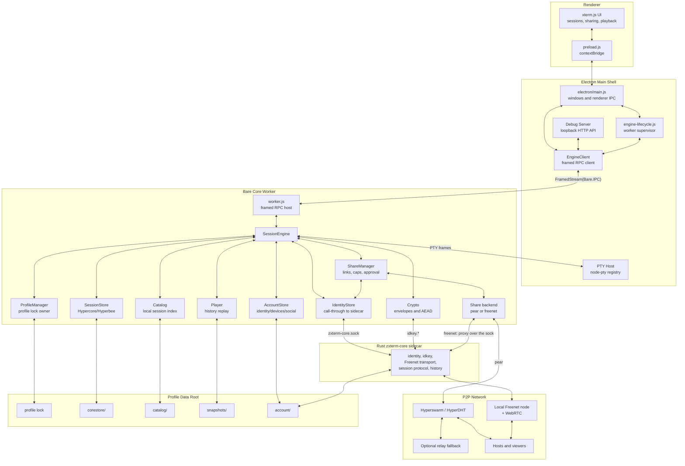

The shell supervises exactly one Bare worker, the core's (`engine/worker.js`);
the worker in turn supervises its `zxterm-core` sidecar.

### 2.3 Process Topology

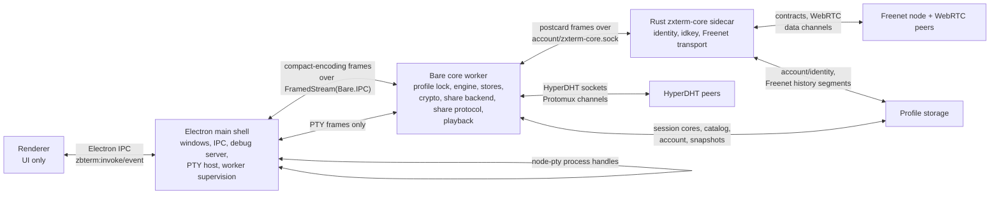

The shell never constructs `SessionEngine` in-process. It spawns
`engine/worker.js` (the `zbterm-core` sidecar entrypoint) through
`engine/client.js::EngineClient` → `engine/spawn-worker.js` → `bare-sidecar`,
restarts it on crash or hang, and forwards renderer/debug requests through
`EngineClient`. The spawn argv is positional and frozen:
`[userData, profileId, profilePath, backend, freenetNode, coreHost?]`, empty
strings (never `undefined`) for the optional ones. `backend` is the
share-backend limit (`--backend` / `ZBTERM_BACKEND`, `electron/backend-limit.js`),
`freenetNode` the Freenet node's WebSocket URL (`--freenet-node` /
`ZBTERM_FREENET_NODE`, `''` for `ws://127.0.0.1:7509/v1/contract/command`), and
`coreHost` the absolute path of the host module that knows where the
`zxterm-core` binary is and how to spawn it (`electron/zxterm-core-host.js`),
because `engine/` itself may not spawn processes.

The worker owns `ProfileManager` and therefore owns profile locks. This
avoids a shell-side lock model that would not generalize to future headless
entrypoints.

### 2.4 Component Responsibilities

| Component | Runtime | Responsibility |
| --- | --- | --- |
| Renderer | Electron renderer | xterm.js rendering, session UI, sharing dialogs, playback controls |
| Preload bridge | Electron renderer/shell boundary | Exposes stable `zbterm:invoke` and `zbterm:event` APIs |
| `electron/main.js` | Electron shell | Windows, app lifecycle, renderer IPC, shell-only commands |
| `engine-lifecycle.js` | Electron shell | Starts/stops/restarts the Bare worker, owns the `ProfileManager` used before an engine runs, pushes ICE servers, reports engine state |
| `EngineClient` | Electron shell | `engine/client.js` (wrapped by `electron/engine-client.js`): spawns the worker, encodes invokes, decodes replies/events, serves PTY frames, preserves renderer contract |
| Debug server | Electron shell | Loopback-only (`127.0.0.1`) REST API using the same `EngineClient` seam as the renderer (`--debug-server`; see [`debug_server_howto.md`](debug_server_howto.md)) |
| PTY host | Electron shell | `electron/pty-host.js`: owns `node-pty` instances (`pty-session.js`) and their systemd scopes (`pty-scope.js`), validates PTY frame session ownership |
| Host options | Electron shell | `backend-limit.js` (share-backend limit), `ice-servers.js` (STUN/TURN list for Freenet), `update-channel.js` (install channel and npm update check) |
| `zxterm-core-host.js` | Shell module, loaded in the Bare worker | Locates the `zxterm-core` binary and spawns it on the worker's behalf |
| `engine/worker.js` | Bare worker | Decodes frames, dispatches invokes, emits events, requests PTY ops |
| `SessionEngine` | Bare worker | Main command/event API and orchestration (`engine/index.js`) |
| `ShareManager` | Bare worker | Link lifecycle, caps, approval, join/host protocol, live encryption, sealed input; holds one share backend |
| Share backends | Bare worker | `engine/backends/`: `pear` (Hyperswarm, relay fallback) and `freenet` (proxy to the sidecar), behind one `ShareBackend` contract |
| Stores | Bare worker | Account, catalog, session log Hypercore, meta Hyperbee, snapshot cache |
| Player | Bare worker | Sparse history fetch, decrypt, seek, frame/data playback |
| `zxterm-core` | Rust sidecar (per profile) | Identity, identity key, Freenet contract client/WebRTC/session protocol/history |

### 2.5 Rationale for the Split

The process split is primarily a security and portability decision. The
Electron shell holds powerful operating-system capabilities: it can create
processes, manage windows, and access Electron APIs. The Bare worker, in
contrast, is responsible for processing untrusted network traffic, parsing
peer messages, replicating data, and handling encryption. Keeping these
responsibilities separate reduces the number of capabilities available to
network-facing code.

If malformed or malicious peer traffic reaches the worker, that code does
not hold a general-purpose `node-pty` process-spawning interface, window
management, or Electron APIs; it can only send the defined PTY commands
through the internal protocol, and the shell performs them only against
sessions it already knows. To be clear about what this does and does not
buy: a fully compromised worker can still write input to existing PTY
sessions — which on a live shell is code execution — so the split is not a
sandbox for the worker. It narrows the interface that network-facing code
exposes, so that a parsing bug is less likely to hand an attacker arbitrary
capabilities directly, and it keeps that attack surface out of the Electron
process itself.

The split also supports future non-Electron entrypoints: because the
`ProfileManager` and profile locks live in the worker, a future headless
application can run the same core without reproducing shell-specific profile
ownership logic.

### 2.6 Core Boundary

The core is `engine/`, which is also the `zbterm-core` npm package: its own
`package.json`, its own version, its own `imports` map, the Bare sidecar
entrypoint `engine/worker.js`, and the host-side supervisor `engine/client.js`.
The contract it publishes is frozen in `docs/CORE-CONTRACT.md` and
`test/core-contract.test.js` fails the build when the two drift. There is no
other worker: `engine/` is the only core directory
(`test/core-boundary.test.js::CORE_DIRS` is `['engine']`). It contains no
host-specific code: no `node-pty`, no `electron`, no process spawning, and no
require that resolves into `electron/`, `renderer/`, or `bin/`. The core owns
*interfaces*; a host supplies the implementations by injection. This is what
makes a second host (a plugin, a headless CLI) possible without touching the
core, and `test/core-boundary.test.js` fails the build if it regresses.
`scripts/core-headless-smoke.js` proves the point from plain Node: it launches
the worker with a fake PTY host, records a session and reads the catalog back.
(The one non-Electron host that existed, a Tabby plugin, is archived and no
longer built.)

The core has two host adapters. The first is the **`zxterm-core` host**: an
object `{ spawn(bin, args), bin() }` that the worker loads from the path in its
6th spawn argument (`engine/zxterm/core.js::setCoreHost`); without one there is
no Rust sidecar, and every identity call fails at once with
`E_BACKEND_UNAVAILABLE`. The second is the **PTY host**. It is a
constructor option, not a require: `new SessionEngine({ ptyHost })` throws an
`EngineError` when it is missing rather than falling back to a local
implementation.

```
spawn(sessionId, { cols, rows, shell, cwd }) -> { write, resize, pause, resume, kill }
attach(sessionId, { cols, rows })            -> { write, resize, pause, resume, kill }
write(sessionId, data)
resize(sessionId, cols, rows)
pause(sessionId) / resume(sessionId)
kill(sessionId)
events: 'data' -> { sessionId, data: Buffer }
        'exit' -> { sessionId, exit: { code, signal } }
```

`attach()` is the optional half of the contract, for hosts that **already own**
a terminal (an editor's terminal tab, an SSH session someone else launched).
`createSession({ mode: 'attach' })` calls it instead of `spawn()`; a host that
does not implement it makes that call fail with `E_INTERNAL`. The handle it
returns has the same five methods and the same two events, deliberately - there
is no second interface - but three semantics differ:

- `kill()` **detaches**: the core lets go of the terminal, the host's terminal
  keeps running. `closeSession`, `deleteSession` and `close()` all go through
  it, so none of them can ever kill a terminal the core did not launch. The
  host then emits `exit`; if it reports no signal, the core records
  `signal: 'detached'` so the catalog says why the session ended.
- `resize()` is never called by the core. With viewers attached the host owns
  `cols`/`rows`; `resize(sessionId, cols, rows)` on the engine only *records*
  what the host reports, and rejects non-positive-integer geometry rather than
  writing it into the timeline, where it would corrupt playback permanently.
- `pause()` is advisory. The core still drives `pause()`/`resume()` at the
  flow limit, but a host that cannot honour them keeps pushing, so the core
  holds post-pause output in a per-session buffer capped at
  `ATTACH_BUFFER_LIMIT` (4 MiB), replays it when acks resume the flow, and
  past the cap drops it - counting the dropped chunks and bytes, warning once
  on `engine:error`, and reporting both in `engine.diagnostics(sessionId)`
  (`session.diagnostics` over the seam). Bounded, never unbounded.

Two implementations satisfy it. `electron/pty-host.js` is the real one: it owns
`electron/pty-session.js` (`node-pty`) and `electron/pty-scope.js` (the systemd
containment for each terminal), and the Electron shell injects it into the
`EngineClient`. `engine/pty-remote.js` is the worker-side proxy the Bare worker
injects: the same API, but every call becomes a `PTY_*` frame on the shell
seam, and inbound `PTY_DATA`/`PTY_EXIT`/`PTY_DETACH` frames become the same two
events. The core cannot tell them apart, which is the point. `pty-remote.js`
implements `attach()` too, as a `PTY_ATTACH` frame (§3.1), so attach mode works
in-process and across the sidecar seam alike: `EngineClient` answers
`PTY_ATTACH` by calling its own `ptyHost.attach()`, and answers with
`PTY_DETACH` when that host has none. `electron/pty-host.js` implements only
the spawn half — the Electron shell always launches its own terminals.
`test/engine-attach.test.js` and `test/engine-attach-seam.test.js` exercise
attach mode in-process and over the seam.

Any new host capability the core needs gets its own named adapter contract in
this shape rather than a direct require. The OS capabilities identity needs —
reading `~/.ssh`, talking to `ssh-agent`, HTTPS for provider key lookups — are
not host adapters: the `zxterm-core` sidecar performs them itself (§6.3).

## 3. The Shell–Worker IPC Seam

The Electron shell and Bare worker communicate over a single duplex pipe. The
transport is a framed binary protocol over `FramedStream(Bare.IPC)`
(`engine/rpc/schema.js` for the codecs, `engine/rpc/pipe.js` for the pipe). JSON is
used only for method bodies and low-rate events; hot paths
use binary frames.

Every message is a frame with three fields: a frame kind, a numeric
identifier, and a binary body. The frame kind determines how the body is
interpreted; the numeric identifier connects a reply to the original
invocation, allowing multiple operations to be in progress concurrently over
the same pipe.

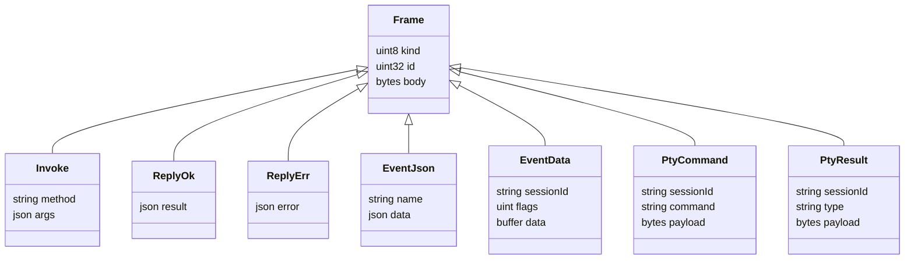

### 3.1 Frame Families

| Frame | Direction | Purpose |
| --- | --- | --- |
| `INVOKE` | shell to worker | The `engine.invoke(method, args)` contract |
| `REPLY_OK` / `REPLY_ERR` | worker to shell | Invoke completion or serialized `EngineError` |
| `EVENT_JSON` | worker to shell | Low-rate events such as list/share/status changes |
| `EVENT_DATA` | worker to shell | Binary `session:data` and `player:data` payloads |
| `PTY_SPAWN/WRITE/RESIZE/KILL/PAUSE/RESUME` | worker to shell | Core-controlled PTY operations |
| `PTY_ATTACH` | worker to shell | Attach to a terminal the host already owns (attach mode, §2.6) |
| `PTY_DATA/EXIT` | shell to worker | PTY output and termination events |
| `PTY_DETACH` | both ways | Worker to shell: let go of an attached terminal; shell to worker: the attached terminal is gone |

`FrameKind` numbers 0–14 are wire-compatible state and are never renumbered.
Kinds 15–21 once carried a Freenet backend's WebRTC connections between the
worker and the shell (`BACKEND_*`); they were removed when WebRTC moved into
the `zxterm-core` sidecar (K11 of zxterm-core, `D-34`), are reserved, and
decode as an unknown kind (`E_CORRUPT`). No Freenet traffic crosses this pipe.

*Invoke frames* carry a method name and arguments from shell to worker
(e.g. `session.create`, `share.join`, `player.open`); the worker dispatches
them to the `SessionEngine`.

*Event frames* are emitted by the worker without a pending request.
Low-frequency events — session-list changes, sharing status, join approval
requests, engine state changes, diagnostics — use structured JSON payloads.
High-frequency terminal data (`session:data`, `player:data`) uses binary
event frames, which avoids the processing and memory cost of converting
terminal bytes into base64 text or large JSON strings.

*PTY frames* implement the narrow terminal capability. Command frames
(spawn, write, resize, kill, pause, resume) travel from the worker to the
shell; result frames (output data, exit notifications) travel from the shell
to the worker. The worker addresses every PTY operation by session
identifier, and the shell maintains the actual `node-pty` registry and
confirms that operations refer to valid terminal sessions.

### 3.2 Ordering: Why One Pipe

There is one duplex pipe, on purpose, and no separate fast lane for data. A
single ordered stream preserves the relative ordering of terminal data,
state events, replies, and lifecycle events: the renderer can never observe
a session-close event before terminal data that was emitted earlier. This is
much easier to reason about than reconciling two streams.

### 3.3 The Second Seam: Worker ↔ `zxterm-core`

The worker reaches the Rust sidecar over a different seam, which the shell
never sees: a local socket at `<profile>/account/zxterm-core.sock` (a named
pipe on Windows, not implemented yet) carrying length-prefixed `postcard`
frames with JSON payloads (`engine/zxterm/codec.js`, `engine/zxterm/client.js`;
`zxterm_core::seam` on the Rust side). `engine/zxterm/core.js::Core` spawns
`zxterm-core sidecar --profile <profile>/account --exit-on-stdin-eof` on the
first call that needs it and restarts it on the next call after it exits. Its
health is the `core.health` method. The seam carries request/response methods
(`identity.*`, `idkey.*`, `freenet.*`, `share.*`, `history.*`), events, and
non-droppable `Chan` frames for raw channel bytes. The binary is found at
`node_modules/@zbterm/zxterm-core-<platform>-<arch>/` (the npm optional
dependency), then `npm/zxterm-core-<platform>-<arch>/` in the app directory
(staged by `scripts/sidecar.js`), with `ZXTERM_CORE_BIN` overriding both; a
missing binary is a named `E_BACKEND_UNAVAILABLE`, never a hang. See
[`CORE-CONTRACT.md`](CORE-CONTRACT.md) §3 and §4.

## 4. Engine API Surface

The public engine surface remains `invoke(method, args)`. The method families
`engine/index.js` dispatches (the authoritative table, with arguments and
results, is [`CORE-CONTRACT.md`](CORE-CONTRACT.md) §5.1, which
`test/core-contract.test.js` keeps in step with the code):

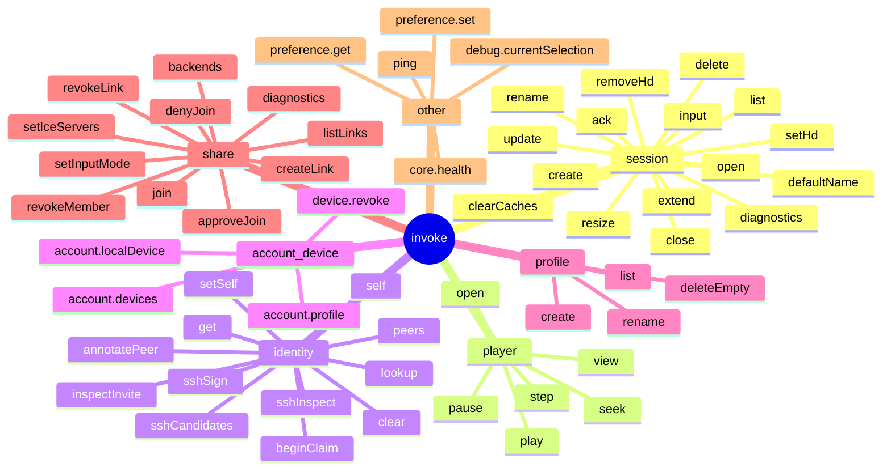

All of these operations are commands executed by the worker; the renderer
never manipulates stores, keys, peers, or terminal processes directly.
Worker-originated events remain renderer-facing `zbterm:event` messages.
Hot data events (`session:data`, `player:data`) are binary across the
shell/core seam and then forwarded to the renderer in the standard event shape.

A few methods never reach the worker: the Electron shell answers them itself
(`electron/main.js`'s `zbterm:invoke` handler). Renderer `profile.*` calls —
including the shell-only `profile.current` and `profile.select`, which starts
the engine for a profile — are served from the shell's own `ProfileManager`
(`electron/engine-lifecycle.js`), since a profile has to be chosen before any
worker runs; the engine's own `profile.*` methods are there for other hosts.
`app.*` (`app.info`, `app.updateCheck`, `app.preference.get`/`set`,
`app.chooseDirectory`) and most `debug.*` methods are shell-only. The
`identity.ssh*` trio is forwarded to the worker even while it is still
booting, because the identity wizard reads SSH keys early.

## 5. Data Model

### 5.1 Profile Model

A ZBTerm profile is the primary ownership boundary for local application
state. Each profile has its own profile lock, account data, session cores,
session catalog, snapshot cache, and peer-to-peer identity.

```mermaid
erDiagram
  PROFILE {
    string id
    string name
    string path
    timestamp lastUsedAt
  }

  PROFILE ||--|| PROFILE_LOCK : owns
  PROFILE ||--|| ACCOUNT_STORE : contains
  PROFILE ||--|| CORE_STORE : contains
  PROFILE ||--|| CATALOG : contains
  PROFILE ||--o{ SNAPSHOT : caches

  PROFILE_LOCK {
    uint version
    int pid
    string hostname
    timestamp createdAt
  }

  ACCOUNT_STORE {
    bytes identityKey
    bytes deviceKey
    bytes dhtPublicKey
    string displayName
  }

  CORE_STORE {
    string root
  }

  CATALOG {
    string sessionId
    string name
    timestamp startedAt
    bool active
  }

  SNAPSHOT {
    string sessionId
    uint64 seq
    bytes encryptedXtermState
  }
```

Profile storage shape:

```text
<userData>/zbterm-profiles/
  profiles.json
  <profileId>/
    lock/owner.json
    account/
      identity/              (owned by the zxterm-core sidecar: self.json,
                              peers/, provider-cache/)
      zxterm-core.sock       (the sidecar's seam, while it runs)
    corestore/
    catalog/
    snapshots/
    preferences.json
```

`<userData>` is ZBTerm's data directory (`--storage <dir>` overrides it). A
host may instead pass an explicit `profilePath` (`--profile-path`), which is
used as the profile root as is. A session shared over Freenet additionally
keeps its sidecar-side history (segment files and a small state file) under
its session store (§7.5).

Only one process may hold a profile lock at a time; this prevents two
application instances from writing to the same profile simultaneously.
Different profiles may run concurrently because they use separate locks and
separate storage roots. The lock is a directory (non-recursive `mkdir` is the
exclusivity gate on both Node and Bare) holding an `owner.json` with the
format version, process identifiers, hostname, and creation time, and is owned
by the worker — the real owner of account state, stores, and the session
engine.

### 5.2 Session Storage Model

Each terminal session has two principal replicated data structures, both
plain Hypercores in the session's own directory under the profile's
`corestore/` (`corestore/<sessionId>/log` and `corestore/<sessionId>/meta`;
the `corestore` package itself is not used): a Hypercore log containing the
encrypted terminal output history, and a Hyperbee over the meta core
containing structured session metadata. The host is the only writer of both
canonical structures — the single-writer rule. Viewers may replicate the data
but never modify the canonical history or metadata. A Freenet share's history
travels differently (§7.5), but the host's own recording is still this log,
and a Freenet viewer's local copy is a store of the same shape.

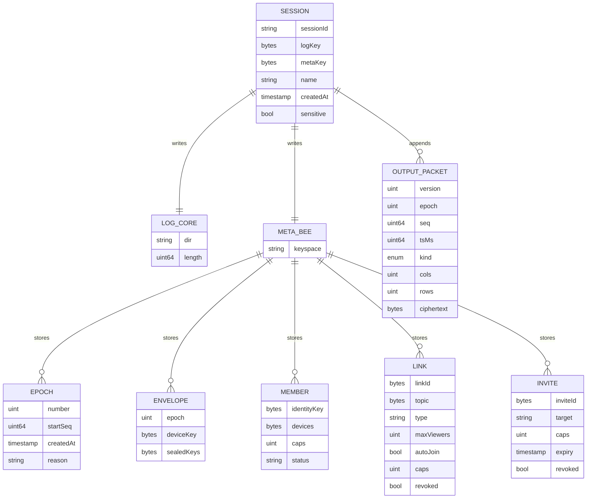

Terminal output is divided into *output packets*, each carrying a format
version, epoch number, sequence number, timestamp, packet kind, terminal
dimensions, and encrypted content. The `sessionId` is derived from the log
discovery key, binding the session identity to the underlying append-only
log.

The metadata Hyperbee stores cryptographic epochs (each identifying a key
generation: number, starting sequence, creation time, and rotation reason),
sealed key envelopes (encrypted session key material intended for one
specific device), members (authorized identities and their capabilities),
share links, and invitations.

## 6. Identity, Devices, and Authorization

### 6.1 Identity and Device Model

ZBTerm distinguishes between user identity and device identity. A user has
a long-term identity key and may have multiple devices; each device has its
own device key, which the identity attests belongs to the user. Each device
additionally owns a DHT keypair used for peer-to-peer Noise authentication
and envelope key material used to receive sealed cryptographic envelopes.

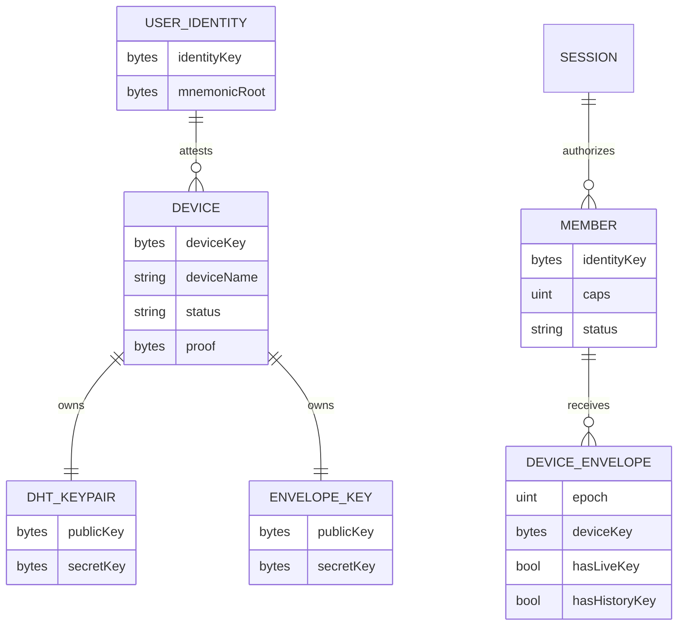

The identity key (derived from a mnemonic the account store keeps) and its
device proof are made and checked by the Rust `zxterm-core` sidecar
(`zxterm_core::idkey`, `X-01`), reached over its seam (`idkey.*`) from
`engine/crypto.js` and `engine/account-store.js`; the upstream identity-key
package the template used is no longer a dependency. There is no migration
from that older scheme (`D-23`, `D-32`): a profile whose identity was made by
it gets a fresh one on its first start, its self claim is cleared, and one log
line (`engine/index.js::OLD_SCHEME_IDENTITY_LOG`) says so.

This separation buys quite a lot: a new device can be added without
replacing the user's identity, a compromised device can be revoked on its
own, session key material can be encrypted separately for each authorized
device, and peer connections are authenticated with device-specific DHT
keys.

### 6.2 Capability-Based Authorization

Authorization is represented through capability bitmasks:

| Capability | Meaning |
| --- | --- |
| `VIEW_LIVE` | Can receive live terminal output |
| `READ_HISTORY` | Can decrypt recorded history for granted epochs |
| `QUICK_CATCHUP` | Can receive host-served snapshot/diff catchup |
| `SEND_INPUT` | Can send sealed input to the host PTY |
| `ADMIN` | Can approve/manage sharing actions that the host executes |

The capabilities are separable: one viewer may receive live output without
the history key; another may inspect historical output but not send input.
Separation is enforced cryptographically as well as logically — a device
that lacks a history key cannot decrypt history even if it obtains the
replicated encrypted log (see §10).

### 6.3 Provider-Backed Identity

The device and identity keys of §6.1 say that two connections come from the
same installation; they say nothing about *who* is on the other end. A
human-meaningful name has to come from somewhere the user already trusts, so
ZBTerm lets a user attach a provider account — in v1, a GitHub username — to
their identity key, and lets the other side check that attachment without
trusting anything the peer says about itself. A peer is shown either as
`octocat@github` once that check passes, or as `1c3b013228bb@UNKNOWN`, the
first twelve hex characters of its identity key, when it does not. There is no
third state and no partial credit: an unproven peer is not merely unlabelled,
it is labelled as unproven.

Proof has two layers, and both must hold. The first is the *claim*, an
ASCII document canonically encoded by `engine/identity/claim.js` as the magic
line `zbterm-identity-claim/v1` followed by `provider`, `subject`,
`identityKey`, `authKey`, `sshFingerprint`, `issuedAt` and `nonce`, one
`key=value` per line, LF-separated with a trailing LF. It is signed with the
user's own SSH key in the SSHSIG format, under namespace `zbterm-identity`
with hash `sha512`, so stock `ssh-keygen -Y verify` accepts our signatures and
we accept its. The claim binds provider and subject to an identity key and to
an `authKey`, and the verifier separately fetches `https://github.com/<user>.keys`
to confirm that the account really publishes the SSH key that signed it. That
alone would be replayable, so the second layer is the *challenge*: the verifier
sends a fresh nonce, and the peer signs
`zbterm-identity-challenge/v1` — again LF-separated ASCII with a trailing LF,
carrying `sessionId`, `challengeId`, `nonce`, `verifierDhtKey`, `proverDhtKey`
and `role` — with the `authKey` the claim named. The two DHT keys inside those
signed bytes are never transmitted; each side fills in what it already knows
about this socket, so a relayed response computed on a different connection
cannot verify. The claim proves the account owns the identity, and the
challenge proves the account is on *this* wire.

Two kinds of SSH key can carry a claim. An `ssh-ed25519` key signs and
verifies as Ed25519; an `ssh-rsa` key signs as `rsa-sha2-512` and never as
bare `ssh-rsa`, and a SHA-1 `ssh-rsa` signature is refused by name rather than
quietly accepted. RSA arrived after the rest of the identity work, for the
blunt reason that plenty of real GitHub accounts still publish nothing else,
and a setup wizard that offers no signable key is a wizard nobody can finish.
An RSA claim is signed either from the private key parsed out of the OpenSSH
container or by asking `ssh-agent` for the signature with the SHA-2 flag set;
verification recovers the encoded message from the signature and compares it
byte for byte against the PKCS#1 v1.5 block it rebuilds — never parsing what
it recovered, which is what makes a low-exponent forgery pointless. ECDSA and
FIDO (`sk-*`) keys are still discovered and listed, and still disabled with a
reason. Because the accepted set only ever grew, an older build that meets an
RSA-signed claim cannot verify it and, by the rule below, refuses the
connection outright — the incompatibility is one-directional and fails closed.

All of this — claim and challenge encoding, SSHSIG signing and verification,
SSH-key discovery, `ssh-agent`, the `<user>.keys` fetch and the verdict on a
peer — is computed by the Rust `zxterm-core` sidecar
(`zxterm_core::identity`, `zxterm_core::ssh`), with the same encodings, key
types, refusals and error texts the earlier JavaScript implementation had.
`engine/identity/{claim,verify,resolver,store}.js` are thin call-throughs over
its seam, kept so the rest of the engine, and the frozen wire constants
(`claim.js::NAMESPACE` and friends), stay where they were. Reading `~/.ssh`,
talking to `ssh-agent` and issuing an HTTPS request are operating-system
capabilities the Bare worker deliberately does not have; they live in a
separate process rather than in the Electron shell, so the shell never
touches key material for identity and never decides whether a peer is
verified. The shell's `identity.ssh*` invokes are forwarded to the worker,
which asks the sidecar. On Pear and loopback shares, ShareManager's challenge
is signed (`_answerIdentityChallenge`) and verified (`_verifyViewerIdentity`,
`_verifyHostIdentity`) through the sidecar; on Freenet shares the challenge is
part of the sidecar's own session protocol (§9.2).

The refusal rule is deliberately narrow: a join is refused only when a peer
presents a claim that is affirmatively bad — a signature that does not check
out, a fingerprint the provider does not publish, a challenge answered wrongly
or not at all within `IDENTITY_TIMEOUT_MS` (15 s). Presenting no claim is a
first-class allowed state, not a failure; an older build and a user who chose
to stay anonymous both simply appear as `@UNKNOWN`. The single non-refusing
failure is an unreachable provider: if the key list cannot be fetched, the peer
is downgraded to unknown rather than rejected, because a network outage on the
verifier's side must never be able to lock a legitimate peer out. Refusal
happens before the approval prompt, so a refused peer is never offered to the
user for approval at all, and a refused peer is persisted as
`provider:'unknown'` — the claimed subject survives only in the emitted
`share:peer-identity` event, never in a record that could later be mistaken for
a proven one.

State lives under the profile's account directory and is written by the
sidecar (`zxterm_core::identity::store`): `identity/self.json` holds the local
claim, `identity/peers/<identityKeyHex>.json` one record per peer seen
(including any local nickname the user attached), and
`identity/provider-cache/<provider>/<subject>.json` the cached key lists, kept
six hours for a positive answer and ten minutes for a negative one
(`zxterm_core::identity::resolver`; the `.keys` base URL can be overridden with
`ZBTERM_GITHUB_KEYS_BASE`). Which providers exist at all is a registry,
`engine/identity/providers.js` on this side and
`zxterm_core::identity::providers` in the sidecar: each entry supplies its id,
its label, whether it needs a resolver, how it renders a display id and how it
validates a subject. Nothing else in the identity pipeline knows provider
names, so adding a second provider is an entry in that registry plus a
resolver in the sidecar — not a change to the claim format, the handshake, or
the storage layout.

## 7. Peer-to-Peer Networking

Share networking sits behind one `ShareBackend` interface
(`engine/backends/types.js`: `describe`, `start`/`stop`, `health`,
`localPeerKey`, `announce`/`withdraw`, `routeFor`, `dial`, `setAdmission`,
`serveHistory`/`attachHistory`/`historyRouteFor`, `diagnostics`, plus
`connection`/`debug`/`error` events). The interface never exposes a mux, a
socket or a swarm. `engine/share-manager.js::ShareManager` owns everything
above it — link records, caps, approval, the `zbterm/ctl` message set,
identity, live encryption, rekey and sealed input — and starts each backend on
the first `share.createLink` or `share.join` that needs it. Several backends can
run at once: each share and each join uses its own, and a session is shared
over one backend at a time (`E_BACKEND_UNAVAILABLE` otherwise).

The registry, `engine/backends/index.js`, is the only file outside a backend
directory that reaches into one (`test/backend-boundary.test.js`). It loads
each backend through a guarded `require`, so a package built without one
reports it absent rather than failing to boot. Which backends a package
carries is a build-time choice (`ZBTERM_BUILD_BACKENDS`,
`forge.config.js::DEFAULT_BUILD_BACKENDS` = `'pear,freenet'`); the worker's
`backend` spawn argument (`--backend` / `ZBTERM_BACKEND`: `pear`, `freenet`
or `none` for local-only) only narrows that set at runtime. `share.backends`
reports each backend's availability.

| Backend | Directory | Transport | History to viewers |
| --- | --- | --- | --- |
| `pear` | `engine/backends/pear/` | One shared Hyperswarm/HyperDHT per profile, Protomux channels, optional blind relay (§7.1–§7.4) | Hypercore replication on the same socket |
| `freenet` | `engine/backends/freenet/` | Proxy to the `zxterm-core` sidecar: Freenet contracts for rendezvous, WebRTC data channels (§7.5) | The sidecar's segment history, live or from a contract |
| loopback | `engine/backends/loopback.js` | In-process hub, tests only; never listed in `share.backends` | Hypercore replication stream |

The same conformance suite (`test/backends/conformance.js`) runs against all
three. Invites name their backend: a Pear link is still emitted in the v1
shape `{ v, linkId, topic, hostDhtKey, claim }` so released builds can join
it, any other backend's link is v2 `{ v: 2, b, linkId, peer, route, claim }`,
and `engine/invite.js::decodeLink` normalises both
(`zbterm://join/<base64url JSON>`).

Sections 7.1–7.4 describe the Pear backend; §7.5 the Freenet backend.

### 7.1 Shared Swarm Architecture

Each running profile has one shared `Hyperswarm`, owned by the Pear backend
(`engine/backends/pear/index.js::PearBackend`, created lazily on the first
announce or dial) and using the profile's DHT identity. Hosting and joining
both use this same swarm, which avoids creating multiple DHT nodes with the
same identity and reduces unnecessary network state. Everything that names
`hyperswarm`, `hyperdht` or `protomux` lives under `engine/backends/pear/`;
the code was moved there from `ShareManager`, not rewritten, so the wire
behaviour is unchanged and interoperates with earlier builds.

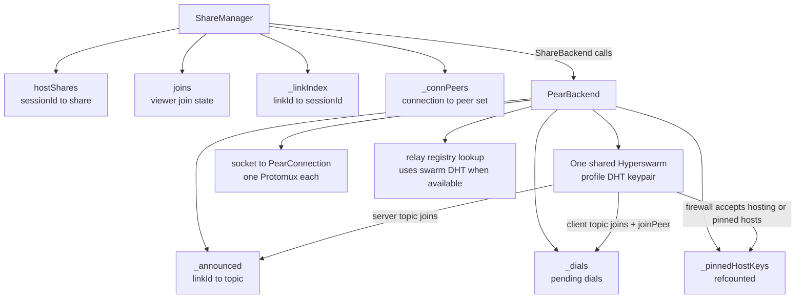

`ShareManager` keeps the session-level mappings: `hostShares` maps session
identifiers to hosted-share state; `joins` holds viewer join state;
`_linkIndex` maps a link identifier to the session it represents; and
`_connPeers` maps each backend connection to the peers it produced, across
every share it carries. The Pear backend keeps the network-level ones: the
topics it announces, the dials in flight, `_pinnedHostKeys` (which remote host
DHT identities are currently allowed), and one `PearConnection` — one
Protomux — per socket (`engine/backends/pear/connection.js`). Because one
socket may carry multiple session relationships — and both host and viewer
roles — peer state cannot be stored per socket; it is scoped to the pair
`(connection, linkId)`.

Key decisions:

- Hosting and joining share the same swarm and DHT keypair.
- Host-side routing never uses `peerInfo.topics`.
- Protomux channel identity routes sessions:
  `protocol = zbterm/ctl`, `id = linkId`.
- A single socket may carry multiple sessions and both host/viewer roles.
- Peer state is per `(socket, linkId)`, not per socket.
- Hypercore replication is attached in the Protomux pair callback, after the
  channel id identifies the target session.
- Viewer-side host pinning is explicit: before sending `join-request`, the
  viewer checks that the connection's remote peer key equals
  `invite.hostDhtKey` (`ShareManager`, on `conn.remotePeerKey`).
- The union firewall remains defense in depth:
  accept if hosting anything or the remote key is in `pinnedHostKeys`.
- `hostDhtKey` is mandatory in invites; unpinnable links are rejected.
- `pinnedHostKeys` is updated before `joinPeer` or topic dial, because the
  Hyperswarm firewall affects outbound connections too.

### 7.2 Protomux Channel Routing

The Pear backend uses Protomux to carry multiple logical channels over one
encrypted HyperDHT socket. The control protocol is named `zbterm/ctl`, and each
control channel uses the share link identifier as its channel identity: the
protocol identifies the type of channel, and the link ID identifies the
specific shared session.

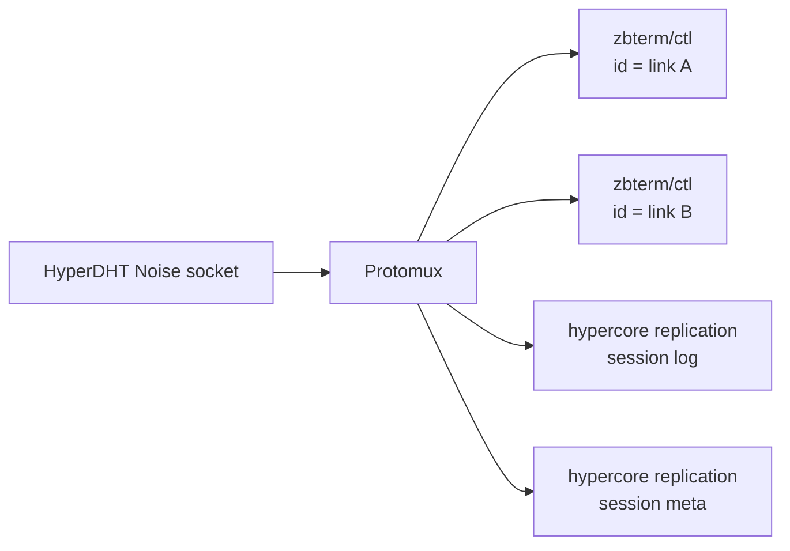

`zbterm/ctl` carries join requests, confirmations, errors, encrypted live
bootstrap/data, sealed input, own-device catalog messages, and session end.
Hypercore replication shares encrypted history and metadata on the same mux.

This design solves a real routing problem: direct `joinPeer` dials do not
reliably expose the topic information needed to tell which hosted session a
connection belongs to, so the host cannot route connections by peer topic
metadata. Instead, the remote peer opens a control channel with a specific
link ID; the host looks up that link ID in its link index, resolves the
correct session and hosted share, and only then attaches the log and
metadata replication streams. A single socket may end up carrying a control
channel for link A, another for link B, and log and metadata replication
streams, with no ambiguity about which is which.

### 7.3 Host-Side Connection Routing

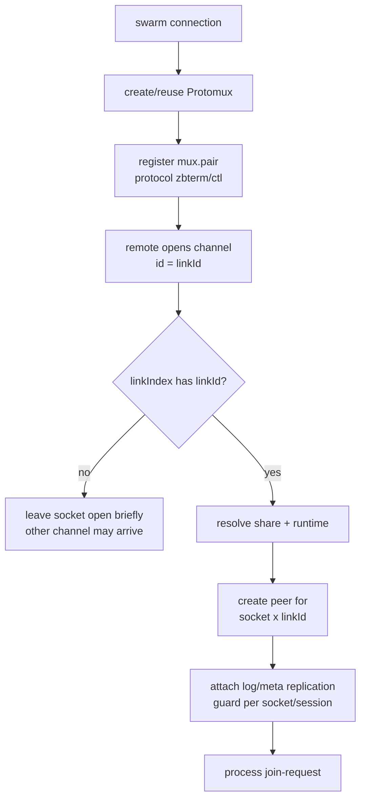

Routing by `peerInfo.topics` is not an option here: it does not behave
reliably for direct `joinPeer` dials, which is exactly the path a viewer
with an invite takes.

### 7.4 Relay Fallback and Registry Lookup

Direct peer-to-peer connectivity may fail because of NAT behavior,
firewalls, or network restrictions. The Pear backend therefore supports an
optional blind relay fallback. The relay never needs access to terminal
plaintext; it forwards already-encrypted streams between peers.

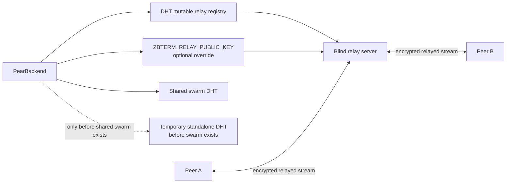

The relay identity may be configured through the environment override
`ZBTERM_RELAY_PUBLIC_KEY`; otherwise ZBTerm discovers relay information
through a mutable DHT registry record at a fixed, non-secret address
(`engine/backends/pear/index.js::REGISTRY_PUBLIC_KEY`), looked up when the
backend starts and every 15 minutes after. Once the profile swarm exists, the
backend reuses the shared swarm's DHT for this lookup; a temporary standalone
DHT is used only if relay lookup must occur before the shared swarm exists.

Relay fallback is offered if forced or if any active dial has waited past
the fallback window (`ZBTERM_RELAY_FALLBACK_MS`, default 5 s). A join started
while another join is already past that window may get relay fallback early.
Direct connection attempts and relay attempts race; direct hole-punching can
still win and take over the connection.

The relay side lives in `relay/`: `relay/server.js` is a standalone
`blind-relay` server on one fixed UDP port (`ZBTERM_RELAY_PORT`, default
49737) with connection caps, and `relay/registry-publish.js` keeps the
registry record pointing at it, re-publishing every 20 minutes. Both are plain
Node; `npm run build:relay` (`scripts/build-relay.js`) bundles them into
standalone executables with `@yao-pkg/pkg`. Running one is described in the
README's [relay setup](../README.md#relay-setup) section. The Freenet backend
does not use this relay.

### 7.5 The Freenet Backend

The Freenet backend (`D-06`, `D-09`, `D-14`; reworked in K11 of zxterm-core,
`D-34`/`D-35`) talks to a Freenet node the user runs — ZBTerm never manages
the node (`D-12`) — at the WebSocket URL of the worker's `freenetNode` spawn
argument (default `ws://127.0.0.1:7509/v1/contract/command`). Without a
reachable node, `share.backends` reports it with a "no Freenet node" detail.

`engine/backends/freenet/index.js` is a thin proxy: every `ShareBackend` call
becomes a `freenet.*` request to the profile's `zxterm-core` sidecar (the same
one identity uses), and channel bytes travel as non-droppable `Chan` frames on
that seam. The sidecar runs the contract client, the rendezvous and
signalling contracts (embedded in the binary; their sources, `.wasm` builds
and BLAKE3 pins live in `zevix/zxterm`'s `contracts/`, and ZBTerm keeps no
copy), the signed and encrypted offer/answer exchange, and WebRTC. JSON
channel messages are still cut into parts in the worker. ICE servers come
from the settings field, `--ice-servers`, `ZBTERM_ICE_SERVERS`, or a default
list of public STUN servers, in that order (`electron/ice-servers.js`,
`D-11`), and are pushed to the worker with `share.setIceServers` after every
engine start.

On a Freenet share the session protocol itself is the sidecar's too (K14 of
zxterm-core, `D-38`; `engine/zxterm/share.js` is ZBTerm's side): the join and
its identity challenge, approvals, epoch keys and envelopes, live output and
its lag resync, and sealed input run in the sidecar, on three channels per
link (`zxterm/ctl`, `zxterm/live`, `zxterm/history`, id `linkId`). ZBTerm keeps
what it owns — the session store, the engine's sessions, the PTY and the UI's
events — and §§8–10 note where each step differs. A Freenet invite's route
carries the session protocol version, and a route from before version 2 is
refused offline with `E_BACKEND_UNSUPPORTED`.

History is the sidecar's as well (K17 of zxterm-core, `D-40`, `D-41`): instead
of replicating the Hypercore, the host feeds its recording into the sidecar's
segment history (`engine/zxterm/history.js::HostHistory`: `history.import`
once at a session's first Freenet share, then `history.append`), which serves
a viewer's ranges live on the `history` channel and publishes closed segments
to the `segment-v1` contract. A viewer reads ranges live while the host is
connected (`share.history`) and from the contract otherwise
(`history.readContract`), so history is available with the host offline, and
appends what it verified to its own local store. Local-only sessions and Pear
shares keep their Hypercore (`D-18`).

## 8. Session Lifecycle and Data Flow

### 8.1 Host Session Creation

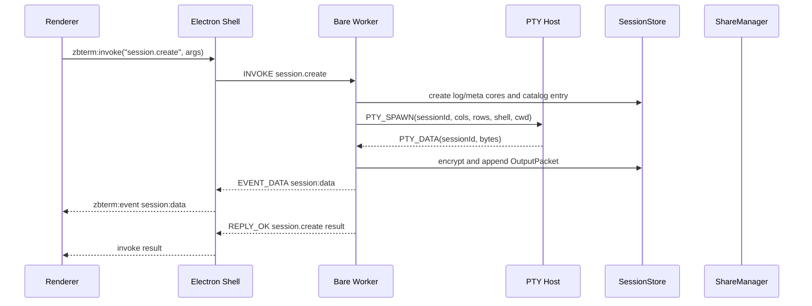

The worker creates the session log and metadata cores and a catalog entry,
then requests a PTY spawn from the shell, which launches `node-pty` with the
configured shell, working directory, and dimensions. When the PTY produces
output, the shell sends a binary PTY-data frame to the worker, which
encrypts the output and appends an `OutputPacket` to the Hypercore log,
emits the data to the local renderer through a binary event, updates its
headless terminal mirror for snapshots, and may send encrypted live data to
authorized viewers. The local user therefore sees output immediately while
the same bytes become part of the encrypted canonical session history.

### 8.2 Live Output and Backpressure

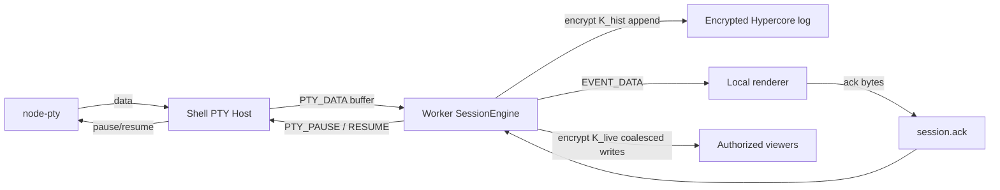

Terminal processes can generate data faster than a renderer, worker, or IPC
connection can consume it, so backpressure is enforced at several levels:

- *Renderer acknowledgment flow control.* The renderer acknowledges bytes it
  has processed; when unacknowledged data exceeds a configured limit, the
  worker requests that the shell pause the PTY, and requests a resume once
  enough bytes are acknowledged.
- *IPC backpressure.* The shell-side PTY host monitors whether the worker can
  drain PTY data from the IPC pipe, and independently pauses the PTY if the
  pipe is congested. This prevents unbounded memory growth in the Electron
  process.

Together these mechanisms propagate pressure back to the source of terminal
output.

**Core backlog and slow viewers** (`S-35`, the `ls -R /` flood). *The core's own
backlog:* the renderer acks at once, so the acknowledgment limit alone never engaged
while the core's mirror and store fell minutes behind; the PTY is therefore also
paused past `engine/index.js::CORE_BACKLOG_LIMIT` (4 MiB not yet through the mirror or into
the store) and resumed once both are below half (`_updateFlow`, one pause for both reasons;
`engine/client.js::_setPtyPaused` likewise unions the shell's reasons, so the pipe's drain never
resumes a PTY the core paused). *Viewers:* live output is sent without a queue limit
on any backend, so a viewer whose channel reports backpressure stops receiving live data and,
`engine/share-manager.js::LAG_RESYNC_MS` (500 ms) later, is sent the host's current screen
(a bootstrap capped at `RESYNC_SCROLLBACK` lines) instead of what it missed; a screen that
meets backpressure too doubles the wait up to `LAG_RESYNC_MAX_MS` (8 s). The viewer's
recording is unaffected (history replicates separately); only its live view skips ahead.

**Freenet shares** (K14 of zxterm-core, `D-38`). On a Freenet share the lag rule
above is the core's, not ZBTerm's: `engine/share-manager.js` hands each PTY chunk to the sidecar
(`share.push`, one request in flight at a time, chunks queued behind it joined into one of at
most 64 KiB, `engine/zxterm/share.js::OrderedRequests`), and the core seals it, skips a viewer
whose live channel reports back-pressure and, after `LAG_RESYNC_MS` (500 ms, doubling to
`LAG_RESYNC_MAX_MS`), asks ZBTerm for the screen (`share.bootstrapNeeded`, carrying `scrollback`
`RESYNC_SCROLLBACK` and `tailBytes` `RESYNC_TAIL_BYTES`, which `engine/index.js::buildLiveBootstrap`
builds and `share.bootstrap` hands back). The four numbers live in `zxterm_core::session` and its
`protocol.md` §11 (zxterm `docs/projects/260928_zxterm-core/`); `test/pipe-backpressure-flood.test.js`
asserts their effect unchanged. The constants in `engine/share-manager.js` govern the Pear and
loopback paths only, which run the paragraph above as it stands.

### 8.3 Remote Terminal Input

Viewer input is treated more carefully than ordinary live output. A viewer
must possess the `SEND_INPUT` capability. Input is sealed to the host device
key, bound to the current epoch, and carries replay-protection counters. The
host validates the capability, epoch, and counter before writing the input
to the local PTY. This prevents unauthorized viewers from controlling the
terminal and prevents captured input messages from being replayed later.

**Freenet shares** (K14 of zxterm-core, `D-38`). On a Freenet share the input path
above is the core's, reached over the seam (zxterm `protocol.md` §10). The viewer's
`engine/index.js::input` hands the keystrokes to `share.input`; the sidecar seals them to the
host's device key under the epoch it holds, counts them (the counter is per device and epoch,
so a viewer that restarts and rejoins is heard again, `S-43`) and sends them on the control
channel. The host's sidecar runs the checks in the order §8.3 names (input mode `'all'` first,
then joined, `SEND_INPUT`, the seal, session, epoch, identity, proof, counter), and hands the
opened input to ZBTerm as `share.input`, which `engine/share-manager.js` writes to the PTY. A
refusal is a `share.inputRefused` event, raised as the same `engine:error` as before. The
`input` message's sealed plaintext is postcard, not JSON. Pear and loopback shares seal
and open input in `engine/share-manager.js::sealInput` and `_openInputMessage`, as described.

## 9. Sharing and Joining

### 9.1 Share Link Creation

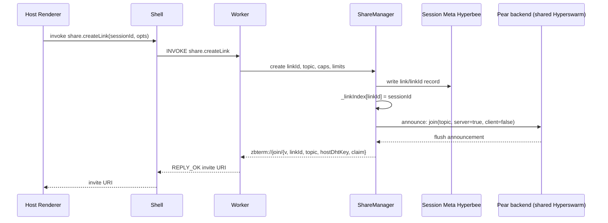

The `ShareManager` creates a link ID, swarm topic, capability set, viewer
limits, and joining rules; writes the link record to the session metadata
Hyperbee; registers the link in the host's link index; and announces the
topic in server mode on the shared swarm (through the backend's
`announce`). The returned invitation URI carries a version, the link ID, the
swarm topic, the host's DHT public key, and the host's identity claim, if it
has one. The `hostDhtKey` (for a v2 link, `peer`) is mandatory — a link
without it is invalid. A Freenet link has the v2 shape of §7, its `route`
opaque to everything but the Freenet backend.

### 9.2 Viewer Join Flow

The viewer join flow is one of the most security-sensitive processes in
ZBTerm.

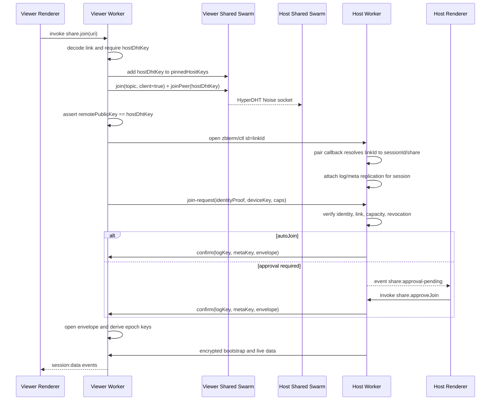

The flow proceeds in stages:

1. **Decode and validate the invitation.** The viewer decodes the invitation
   and requires the host DHT key to be present. The invitation determines
   which swarm topic to use and which host identity to expect.
2. **Pin the host.** Before attempting the connection, the viewer adds the
   expected host DHT key to its pinned host-key set. This must occur before
   joining the topic or dialing, because the Hyperswarm firewall affects
   outbound as well as inbound connections.
3. **Establish the connection.** The viewer joins the topic in client mode
   and may also dial directly via `joinPeer(hostDhtKey)`. When the
   connection is established, the viewer checks that the remote Noise
   public key exactly matches the host DHT key from the invitation. This is
   application-layer host pinning. If the key does not match, the viewer
   must not send identity information or a join request.
4. **Open the control channel.** The viewer opens a `zbterm/ctl` channel
   with the link ID as channel identifier; the host resolves the link ID
   through its link index to determine the intended session.
5. **Attach replication.** Once the session is identified, the host attaches
   replication for the session log and metadata. Replication may begin
   before final approval: this does not reveal readable terminal content,
   because the replicated data is encrypted and the viewer does not yet
   possess the session keys. Hypercore capability checks and encrypted
   session material prevent pre-authorization disclosure; the confirm
   message and key envelope remain post-validation.
6. **Send the join request.** The viewer sends an identity proof, its device
   key, and the requested capabilities. The host verifies the user's
   identity, the device proof, the link status, the requested capabilities,
   viewer capacity, expiration, and revocation state.
7. **Approval.** Links may allow automatic joining; otherwise the host
   renderer receives an approval-pending event, and the host user invokes
   approve or deny.
8. **Confirmation and key delivery.** After approval, the host sends a
   confirmation containing the session replication information and a sealed
   key envelope encrypted to the viewer's device. The viewer opens the
   envelope, derives the epoch keys for its granted capabilities, and then
   receives encrypted bootstrap state and live terminal data, which it
   converts into ordinary session-data events for its local renderer.

**Freenet shares** (K14 and K17 of zxterm-core, `D-38`, `D-40`). On a
Freenet share the join above is the core's, reached over the seam (zxterm
`protocol.md` §§5–9), and every step after "Establish the connection" runs in
the sidecar. The viewer's `share.join` sends the invite's route, the host key
it must pin and the link; the sidecar dials, checks the route's protocol
version before anything else (a route without `params.pv = 2` is refused
offline, `E_BACKEND_UNSUPPORTED`, "The invite uses an older Freenet session
protocol; the host must upgrade and share a new invite"), pins the remote key,
opens the three session channels (`zxterm/ctl`, `zxterm/live`,
`zxterm/history`, id `linkId`) and sends the join request. The identity
challenge runs inside the two sidecars; `confirm` carries no bootstrap, the
first `Bootstrap` on the live channel does, and ZBTerm builds it when the
sidecar asks (`share.bootstrapNeeded`). ZBTerm hears the outcome as
`share.joinChanged` (`approval-pending`, `confirmed` with the session's keys
and envelope, `joined`, `failed`) and turns it into the same
`share:join-changed` events Pear joins produce; on `confirmed` it registers the
remote session with the engine. On the host, the sidecar raises
`share.pending` for an approval (the host UI's `share:approval-pending`),
grants, and reports `share.granted`; ZBTerm writes the member and the link's
counters to the store. The host-account device check ZBTerm's store makes
(`_isRevoked`) stays ZBTerm's, applied on `share.pending` (`D-39`). Step 5
does not apply: nothing is replicated on the connection; the core serves the
`history` channel from the history the host opened at `share.hostOpen`
(`ShareManager#_coreOpenHistory`), and a viewer asks for ranges through
`share.history` (§7.5). Pear and loopback joins run the stages above as they
stand.

## 10. Cryptographic Model

The cryptographic design uses several distinct key layers: the user identity
key (`zxterm_core::idkey`, made and checked in the sidecar, §6.1), the device key attested by the identity, the DHT
keypair used for Noise-authenticated network connections, and the session
epoch master key. For each epoch, the host generates a master key K_e, from
which separate history and live keys are derived: the history key encrypts
stored terminal packets, and the live key encrypts live peer traffic.
Separate derivation limits cross-purpose key reuse. The `crypto_kdf` contexts
of the history, live and snapshot keys (`engine/crypto.js`) are zxterm's
since K11 of zxterm-core (`D-36`), with no compatibility: history, snapshots
and live traffic keyed under the earlier contexts no longer decrypt.

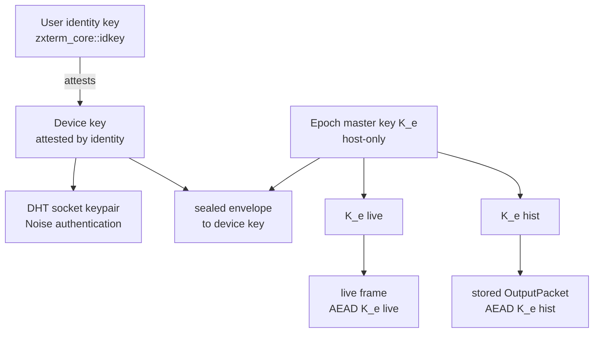

### 10.1 Authenticated Encryption and Associated Data

Encrypted packets use authenticated encryption with associated data (AEAD).
The associated data binds `sessionId`, `epoch`, `seq`, and the sender device
key to the ciphertext. An encrypted packet therefore cannot be moved into
another session, another epoch, another sequence position, or another sender
context: even when the ciphertext is unchanged, authentication fails if the
bound context is incorrect.

### 10.2 Device Envelopes

The host seals epoch key material separately for each authorized device. An
envelope may contain a live key, a history key, or both, and history keys
are omitted when `READ_HISTORY` is not granted. A device granted only
live-view access receives live key material but no history key, so
replicated terminal history remains unreadable to it.

### 10.3 Sensitive Sessions

Sensitive sessions use stricter envelope handling: their envelopes are not
persisted in replicated metadata. Instead, epoch keys are requested through
the live connection and kept only in memory, reducing the amount of
recoverable key material present in replicated storage.

### 10.4 Revocation and Forward Security

When a member, link, or device is revoked, the host rotates to a new epoch,
and new key envelopes exclude the revoked device, which therefore cannot
decrypt future data. This is forward-secure revocation. No system can force
a viewer to forget plaintext it has already seen, and ZBTerm makes no such
claim: revocation protects future epochs, not already-disclosed information.

**Freenet shares** (K14 of zxterm-core, `D-38`). On a Freenet share the epoch
master key, its derived keys and the sealed envelopes of §10.2 are the core's: `share.hostOpen`
mints the first epoch the sidecar holds (one above the store's, so the host never encrypts under
an epoch another process minted), and every rotation (a join, a member's revocation, a link's
revocation with a member behind it; a disconnect rotates nothing, owner's `Q-15`) reaches ZBTerm
as `share.epoch` with the host's own envelope, one per member device and, for a joiner, the
history-only envelopes of the earlier epochs. The core persists nothing:
`engine/session-store.js::applyCoreEpoch` writes them to the session's meta core exactly where
`rotateEpoch` would have (`epoch/<n>`, `env/<n>/local`, `env/<n>/<deviceKeyHex>`,
`epoch/current`), and a session marked sensitive gets its keys in memory only. The
derivations, the AEAD and the envelope bytes are unchanged (zxterm `protocol.md` §3). Pear and
loopback shares mint and seal in `session-store.js::rotateEpoch`, as §10.2 and §10.4 describe.

### 10.5 Invariants

- Epoch master keys are generated by the host.
- History and live keys are derived separately.
- Packet AEAD associated data binds `sessionId`, `epoch`, `seq`, and sender
  device key.
- Envelopes are sealed per recipient device and optionally omit history keys
  when `READ_HISTORY` is not granted.
- Revocation is forward-secure: new epochs and future envelopes exclude
  revoked devices, but already-seen plaintext cannot be clawed back.
- Sensitive sessions do not persist envelopes in replicated metadata; epoch
  keys are requested live and kept in memory.

## 11. Recording, Snapshots, and Playback

Playback combines encrypted Hypercore history, metadata, local snapshots,
and a headless terminal emulator (`@xterm/headless`). A terminal is not
simply a text log: its visible state depends on control sequences, cursor
movement, screen clearing, resizing, colors, alternate screens, and other
stateful operations. Seeking to a point in time therefore requires replaying
terminal operations into an emulator.

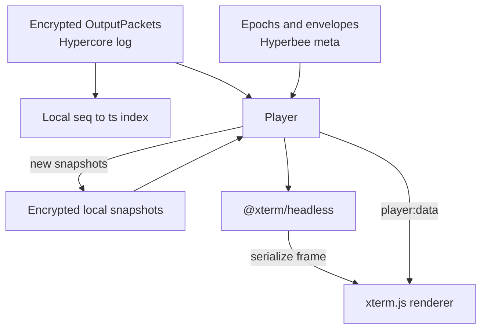

Playback is sparse and local-first: the player avoids loading or replaying
the entire history when unnecessary, maintaining local snapshots and
sequence-to-time indexes. To seek, the player finds the nearest local
snapshot before the target sequence, restores it into the headless terminal,
decrypts and applies the remaining packets up to the target, serializes the
reconstructed terminal state, and swaps it into the visible terminal. The
first playback pass builds snapshots and indexes as it proceeds, so future
seeks can begin from nearby snapshots rather than replaying the entire
session.

## 12. Worker Crash Recovery

The worker may crash, become unresponsive, or exceed an invocation timeout.
The Electron shell supervises it.

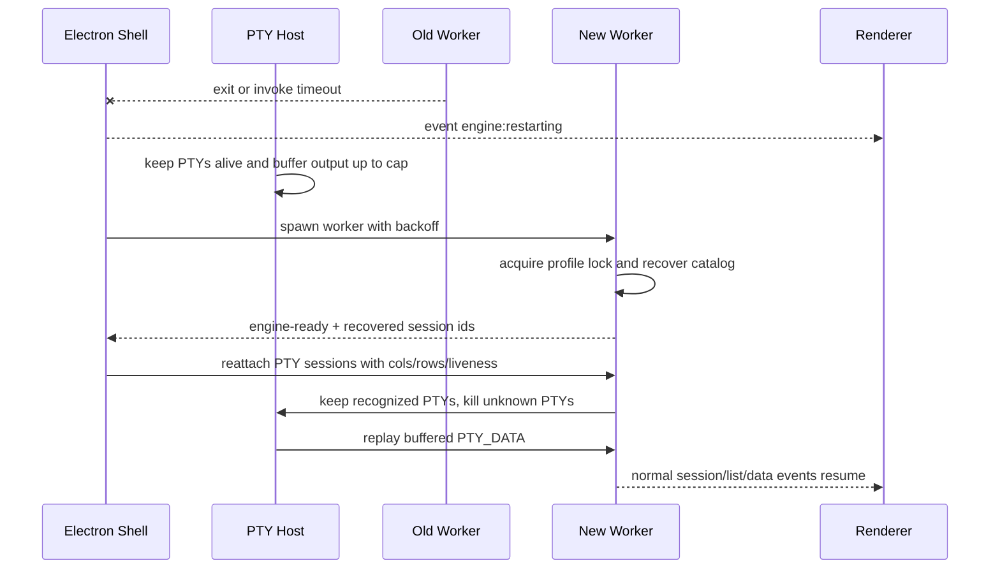

When a failure is detected, the shell emits an engine-restarting event to
the renderer. The native PTY processes remain alive because they are owned
by the shell rather than the failed worker; the shell temporarily buffers
PTY output up to a configured cap. It then starts a new worker with restart
backoff. The new worker acquires the profile lock, recovers the catalog and
session state, and reports the sessions it recognizes; the shell reattaches
the surviving PTY processes to those sessions. Recognized PTYs are retained,
unknown PTYs are terminated, and buffered PTY output is replayed to the new
worker before normal session events resume.

This recovery path is one of the strongest practical benefits of keeping
`node-pty` in the shell: a worker crash does not terminate the user's shell
processes.

Restart policy:

- At most three automatic restarts per 60 seconds.
- Beyond the limit, the shell surfaces a fatal `engine:error` and returns to
  a profile-required state instead of crash-looping.
- PTYs survive because they live in the shell.
- Swarm connections and in-flight join approvals are lost, matching
  whole-app restart semantics but scoped to the worker.
- The old worker's `zxterm-core` sidecar exits with it (its stdin pipe
  closes), taking any Freenet connections along; the new worker starts a
  fresh one on first use, retrying five times, 100 ms apart, while the old one
  still holds the profile.
- ICE servers are pushed to the new worker again once it reports ready.
- Viewers are not auto-reconnected by this architecture.

## 13. Security Boundaries and Invariants

### 13.1 Trust Boundaries

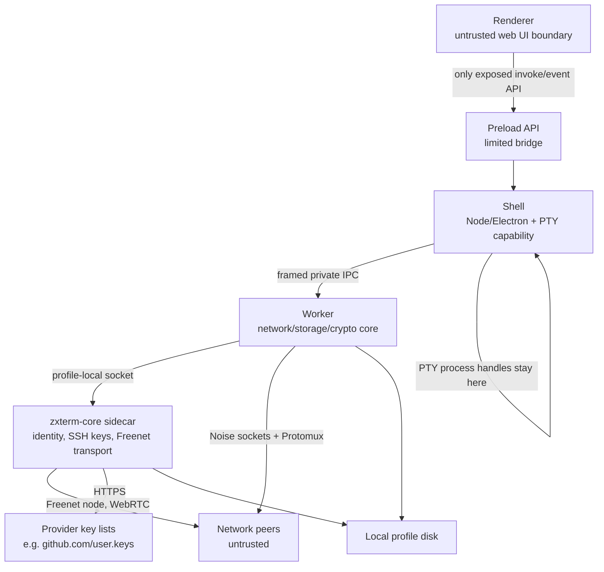

The renderer is treated as an untrusted web user-interface boundary and
communicates only through the limited preload API. The shell owns native
application and PTY capabilities and communicates with the worker over a
private framed IPC protocol. The worker owns network, storage, replication,
session authorization, and cryptography. The `zxterm-core` sidecar holds the
OS capabilities identity needs (`~/.ssh`, `ssh-agent`, HTTPS to the provider)
and the Freenet transport; it is reached only from the worker, over a socket
in the profile's own `account/` directory. Network peers are untrusted.
Profile storage is local but contains encrypted and security-sensitive
state.

The main capability split is intentional: network-facing parsing,
replication, sharing, and crypto run in the worker, while process-spawning
PTY capability remains in the shell behind a narrow session-addressed API.
The debug server is loopback-only and uses the same engine seam as the
renderer.

The architecture applies both logical and cryptographic authorization. The
host checks whether a viewer is authorized, but even a viewer that obtains a
network socket or replicated encrypted data gains no confidentiality unless
it received the correct cryptographic key envelope. The central security
principle: *socket access is not equivalent to data access.* Key
distribution is the primary confidentiality mechanism; socket checks and
firewalls are defense in depth.

### 13.2 Core Architectural Invariants

1. One running profile owns one core engine, one active share backend
   (for Pear, one shared swarm), and one `zxterm-core` sidecar.
2. The Bare worker owns the profile lock, account state, stores, crypto,
   sessions, playback, and sharing.
3. `node-pty` remains in the Electron shell.
4. All PTY operations cross a narrow, session-addressed protocol.
5. The renderer-facing invoke-and-event contract remains stable.
6. The host is the only writer of canonical session history and metadata.
7. The link ID, not swarm topic metadata, routes a connection to a hosted
   session.
8. The viewer verifies that the connected host DHT key matches the key in
   the invitation.
9. The host DHT key must be pinned before dialing.
10. History confidentiality is enforced through key distribution.
11. Revocation protects future epochs but cannot erase already-viewed
    plaintext.
12. One IPC pipe preserves event ordering.

### 13.3 Invitation Trust and Impersonation (TODO!)

Part of this is now answered by §6.3: a peer that proves a provider account is
shown as `user@github`, everyone else is shown as `@UNKNOWN`, and a peer whose
claim fails outright is refused before the join is ever offered for approval.
What follows is what remains.

**TODO!** Invitation to a session is a security risk. A malicious sender may
impersonate someone you know and trust, share the keyboard with you, and ask
you to log in somewhere where you type a password — and the host-side program
may proxy and/or record your keystrokes.

We must help the user detect suspicious invites by displaying:

- The session name as set by the user.
- The username and hostname of the inviting user.

Additional required protections:

- If an attempt is made to reuse a one-time key that was sent to a user by
  another user, the originating user must be reported.
- Likewise, when a key was sent to a known user and a different user tries to
  connect with that key, the host must be notified.

## 14. Design Decisions and Tradeoffs

| Decision | Rationale |
| --- | --- |
| Use channel id routing instead of topic metadata | Direct `joinPeer` dials do not reliably expose topic routing information |
| Make `linkId` the Protomux channel id | Allows one socket to carry multiple sessions and avoids duplicate unkeyed channels |
| Keep one shared swarm per profile | Aligns with Pear architecture and avoids multiple DHT nodes using one keypair |
| Move `ProfileManager` into the worker | Generalizes to future headless entrypoints and avoids shell/worker lock deadlocks |
| Keep PTY in the shell | `node-pty` is not Bare-compatible; network-facing core also loses process-spawn capability |
| Preserve `invoke(method,args)` | Avoids renderer/debug API churn; hot paths are optimized separately |
| Use binary frames for data and PTY traffic | Avoids base64/JSON overhead for terminal data |
| Use one IPC pipe | Preserves ordering between data and lifecycle events |
| App-layer host pinning plus union firewall | Exact per-join host verification with firewall defense in depth |
| Require `hostDhtKey` in links | Every join must be pinnable before sending identity material |
| One engine implementation, worker-only | No in-process twin of the engine to keep in sync; the test gates carry the risk instead |
| Share networking behind one `ShareBackend` interface | Pear and Freenet (and a test loopback) pass one conformance suite; a build can drop a backend without code changes |
| Identity and the Freenet transport in a Rust sidecar, spawned by the worker | One implementation shared with `zevix/zxterm`; OS capabilities (`~/.ssh`, `ssh-agent`, HTTPS, WebRTC) stay out of both the Bare worker and the Electron shell; no Freenet traffic on the shell/worker pipe |
| No OTA updater (`D-08`, `D-25`) | Installs update like any desktop app or through npm; no `pear-runtime`, upgrade key or staging pipeline to maintain |

Several of these decisions trade simplicity in one place for complexity in
another. One shared swarm per profile reduces duplicated DHT state but makes
routing more complex, since a single socket may represent multiple sessions;
that complexity is absorbed by Protomux channel identifiers. Keeping the
renderer API stable reduces application churn but requires the shell to
translate between renderer requests and worker frames. JSON keeps
low-frequency control operations simple and debuggable, while binary frames
keep the hot paths cheap. One ordered pipe simplifies ordering reasoning but
means all traffic shares one backpressure domain. Permitting replication
before join approval improves connection setup and Hypercore integration,
with confidentiality retained because readable key material is not delivered
until authorization completes. Keeping PTYs alive during worker failure
improves resilience at the cost of reattachment, buffering, and recognition
logic. Finally, having exactly one engine implementation — worker-only, with
no in-process variant — avoids the slow divergence that two parallel
implementations always develop; the test suite carries that risk instead.

## 15. Testing and Verification

An architecture with this many moving parts is only as good as the checks
that keep it honest. The gates that must stay green:

- `npm test` — the unit and integration suite (`test/*.test.js` and
  `test/backends/*.test.js`), including RPC schema round-trip and
  garbage-input tests for the shell/worker seam, the `zxterm-core` seam codec
  and client, the core contract and core boundary gates
  (`test/core-contract.test.js`, `test/core-boundary.test.js`,
  `test/backend-boundary.test.js`), and the `ShareBackend` conformance suite
  run against the Pear (local `hyperdht` testnet), Freenet (throwaway
  local-mode node, `test/helpers/freenet-node.js`) and loopback backends. A
  test that reaches identity code installs the sidecar host from
  `test/helpers/zxterm-core.js`.
- `node test/debug-server-e2e.js` — end-to-end coverage through the debug
  REST API.
- Multi-hosted-session e2e: several sessions hosted concurrently on one
  shared swarm.
- Worker crash/restart e2e: PTY survival, reattachment, and buffered replay.
- Adversarial e2e: wrong host keys, and concurrent hosting plus joining on
  the same profile.
- Identity e2e (`node test/debug-server-e2e.js --identity-only`): three app
  instances against a stubbed `.keys` endpoint — a host that proves its
  provider account, a viewer that verifies it, and a host whose claim names a
  key the provider does not publish and whose join must be refused.
- `npm run test:canary <storage-dir>` — scans a profile's storage for a
  plaintext canary string, proving recorded output is only stored encrypted.
- `node scripts/core-headless-smoke.js` — the core runs without Electron.
- `npm run pack:check` and `npm run smoke:install` — the npm tarball's
  contents, and a throwaway global install of it (`zbterm doctor` green, the
  Bare engine boots when a display is available). CI (`integrate.yml`) runs
  lint and a cross-platform `npm install -g` matrix on every push and PR.
- Manual smoke: create a session, share it, join from another profile,
  revoke, play back, and inspect diagnostics.

## 16. Known Non-Goals

A few things are out of scope on purpose:

- Viewers do not auto-reconnect after a host or worker restart; they rejoin
  through the normal join flow.
- There is no per-session "stop hosting and leave topic" command.
- Non-host admins do not rotate keys in v1. Every action that affects
  confidentiality is executed by the host.

## Appendix A. Development Reference

### A.1 Scripts

npm only — `pnpm` breaks `forge.config.js`.

| Script | Runs |
| ------ | ---- |
| `npm start` | `electron-forge start -- --no-updates` (`--no-updates` is accepted for compatibility and does nothing) |
| `npm test` | `brittle-node test/*.test.js test/backends/*.test.js` |
| `npm run test:debug-server` | `node test/debug-server-e2e.js` |
| `npm run test:canary` | `node test/canary-scan.js <storage-dir> [canary]` |
| `npm run lint` | `prettier --check` + `lunte` on `package.json`, `forge.config.js`, `electron/`, `engine/`, `renderer/`, `test/` |
| `npm run format` | The same files, `prettier --write` + `lunte --fix` |
| `npm run vendor:assets` | `node scripts/vendor-assets.js` (copies xterm and Font Awesome into `renderer/vendor/`; also runs as `prestart`, `pretest`, `prepack`) |
| `npm run package` | `electron-forge package` (no distributables; `ZBTERM_FORGE_OUT_DIR` redirects `out/`) |
| `npm run make` | `electron-forge make` (build distributables) |
| `npm run build:sidecar` | `node scripts/sidecar.js build` (builds the Rust `zxterm-core` from the `zxterm/` submodule and stages it under `npm/zxterm-core-<platform>-<arch>/`; run before packaging) |
| `npm run build:relay` | `node scripts/build-relay.js` (standalone relay executables; `--jobs N` builds N targets at once) |
| `npm run icons` / `npm run logo` | Regenerate the logo and icons from `renderer/logo-ascii.js` / print the logo in the terminal |
| `npm run pack:check` | `scripts/npm-pack-check.sh`: lint, tests, `npm pack`, tarball assertions |
| `npm run smoke:install` | `scripts/npm-smoke-install.sh <tarball>`: install into a throwaway prefix and check it |
| `npm run release:npm` | `scripts/release-npm.sh`: dry-run plan by default; `--tag` makes the version commit and tag (publishing happens in CI on the tag) |
| `./build_all.sh` | Builds everything: relay executables (all platforms), the `zxterm-core` sidecar for the host, GUI app package for every platform whose sidecar is staged under `npm/` (others, and win32, are skipped with a note) + GUI installer for the host platform only. `--relay-only`, `--gui-only`, `--no-make` narrow it down; `-j [N]` builds N relay targets at once (default: all) alongside the sidecar and GUI steps. |
| `./install_deps.sh` | System packages (Ubuntu/Debian/Fedora), `rustup`, `npm install`; `build_all.sh` and `run.sh` offer to run it |
| `./run.sh` | Run from source (`--dev`), from `out/` (`--packaged`) or the relay (`--relay`); `--scratch` uses a throwaway `HOME` and storage |

### A.2 Distribution and Updates

ZBTerm has no peer-to-peer OTA updater in any build (`D-08`, `D-25`): it does
not depend on `pear-runtime`, and there is no `pear.json`, no
`package.json#upgrade`, no `workers/main.js` and no forge upgrade gate. It
ships through two independent channels:

- **Desktop installers** — `npm run make` (AppImage, Flatpak and Snap on
  Linux, dmg on macOS, MSIX on Windows — the makers `forge.config.js`
  configures; `.github/workflows/build-release.yml`, manual). A packaged build
  updates by installing a newer package. The `zxterm-core` binary is staged
  by `npm run build:sidecar` and shipped inside the package; asar stays off
  because the Bare worker and the sidecar are spawned from real file paths.
- **npm** — `npm install -g zbterm` (Linux and macOS, x64 and arm64), published
  from a `v*` tag by `.github/workflows/publish.yml` after `integrate.yml`
  passes. The platform's sidecar arrives as the optional dependency
  `@zbterm/zxterm-core-<platform>-<arch>` (built per platform by
  `.github/workflows/packages.yml` and injected into `optionalDependencies`
  at publish time only). `bin/zbterm.js` launches Electron
  on the app (retrying with `--no-sandbox` when Chromium's SUID sandbox is
  unavailable) and adds four subcommands: `zbterm update` (runs
  `npm install -g zbterm@latest`), `zbterm doctor` (one actionable line per
  thing an npm install can get wrong, `bin/lib/doctor.js`), and
  `zbterm install-desktop` / `uninstall-desktop` (a user-scoped Linux desktop
  entry and `zbterm://` scheme handler, `bin/lib/desktop.js`). The install
  script (`bin/lib/postinstall.js`) prunes other platforms' prebuilds and
  refuses native addons linked against the host's shared Node runtime
  (`bin/lib/native-linkage.js`).

The only update mechanism inside the app is a registry check on npm installs:
`electron/update-channel.js` detects the channel (`npm`, `packaged` or `dev`)
and, for `npm` only, polls the registry for a newer `zbterm`
(`--no-update-check` turns it off), and the renderer shows the result
(`renderer/app.js::wireNpmUpdater`). See [`RELEASING.md`](RELEASING.md) and
the README's [Updating](../README.md#install-update) section.

### A.3 Code Pointers

- Share control protocol, links, approval, live encryption and sealed input:
  `engine/share-manager.js`; the `ShareBackend` contract:
  `engine/backends/types.js`; the registry: `engine/backends/index.js`.
- Pear backend, shared swarm, pinning and relay/registry lookup:
  `engine/backends/pear/index.js` (including the hardcoded, non-secret
  `REGISTRY_PUBLIC_KEY` used to resolve the default relay) and
  `engine/backends/pear/connection.js`; the relay itself: `relay/`.
- Freenet backend: `engine/backends/freenet/index.js` (proxy to the sidecar);
  the Freenet session protocol and history on ZBTerm's side:
  `engine/zxterm/share.js` and `engine/zxterm/history.js`.
- Invite codec: `engine/invite.js`.
- Shell/worker frames: `engine/rpc/schema.js`, `engine/rpc/pipe.js`; worker
  spawn and supervision: `engine/client.js`, `engine/spawn-worker.js`,
  `engine/worker.js`, `electron/engine-lifecycle.js`.
- Permission capability bitmask definitions: `engine/caps.js`.
- Identity: `engine/identity/{claim,verify,resolver,store}.js` are thin
  call-throughs, `engine/identity/providers.js` the provider registry. The
  code is the Rust `zxterm-core` sidecar's, in `zevix/zxterm` (the `zxterm/`
  submodule): `zxterm_core::identity::{claim,verify,resolver,store,github,providers}`,
  `zxterm_core::ssh`, `zxterm_core::idkey`, served over
  `zxterm_core::seam::methods::Dispatcher`. ZBTerm's side of that seam:
  `engine/zxterm/{core,client,codec}.js` and the host module
  `electron/zxterm-core-host.js`; build and staging: `scripts/sidecar.js`.
- Freenet contracts (`pointer-v1`, `segment-v1`, `signalling-v1`) and their
  pins: `zxterm/contracts/`.
