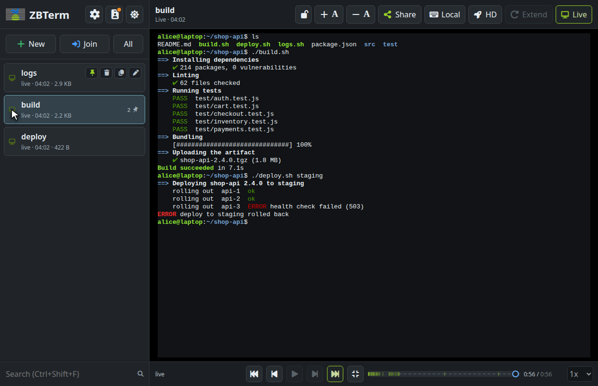
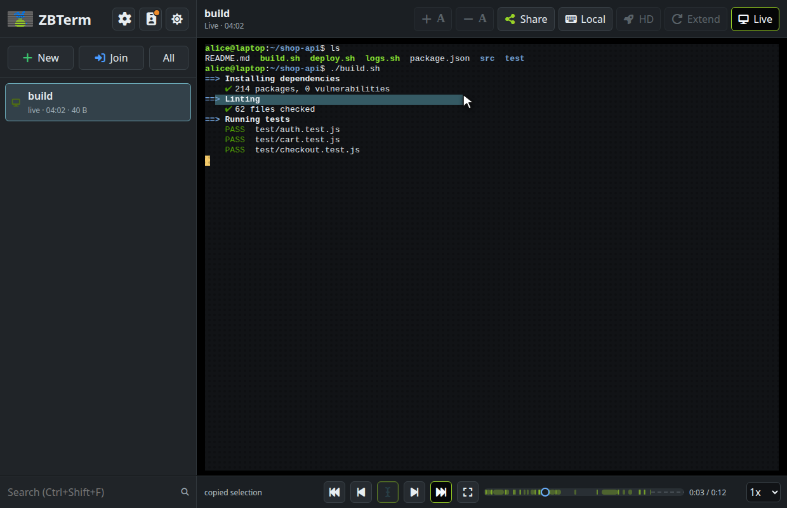
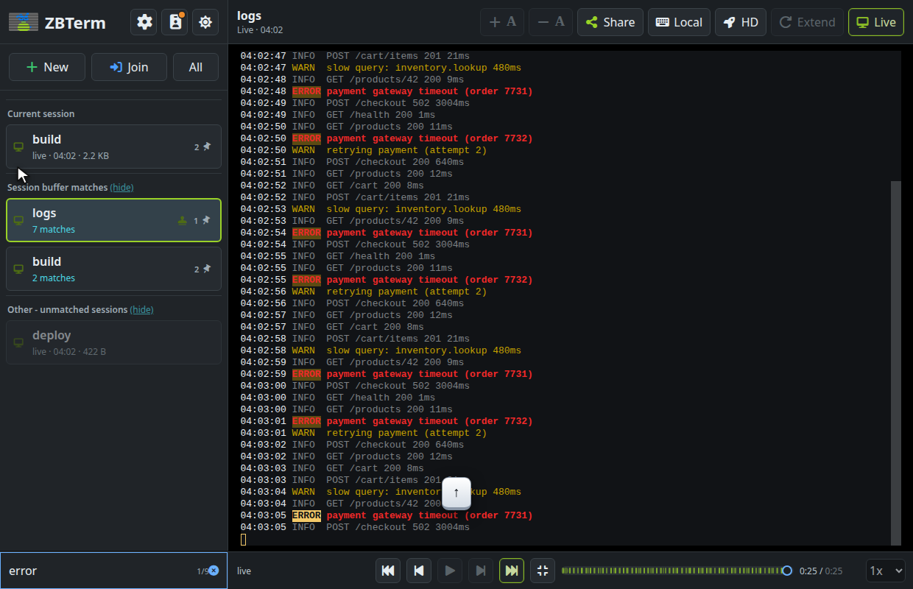
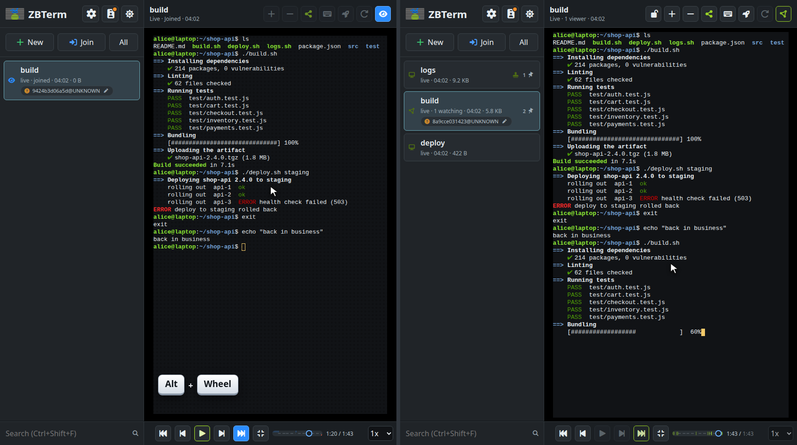

# ZBTerm: the tour

ZBTerm is a terminal that remembers. Every session is recorded as it runs and
encrypted on disk, so you can scroll back through time, not just through lines,
replay what happened, search it, and hand a live view of it to someone else
over a peer-to-peer link that no server can read.

This page is the whole app for a new user: what is on screen, what each
feature does, and every key and mouse binding. To see it move, run
[`./demo.sh`](demo.md): it drives the real app through everything below.

<p align="center">
  
</p>

- [The window](#the-window)
- [Five minutes](#five-minutes)
- [Sessions](#sessions)
- [Time travel](#time-travel)
- [Search](#search)
- [Pins, order and templates](#pins-order-and-templates)
- [Sharing](#sharing)
- [Identity](#identity)
- [Profiles](#profiles)
- [Settings](#settings)
- [Key bindings](#key-bindings)
- [Mouse](#mouse)
- [Command line](#command-line)

## The window

| Where | What |
| ----- | ---- |
| **Side pane** (left) | The logo (click: fold the pane away), Settings, Identity, the theme switch; **+ New**, **Join**, the **All / Active** filter; the session list. |
| **Top bar** | The selected session's name and state, then its controls: terminal size lock, font size **+A** / **-A**, **Share**, the keyboard button (**Local** / **Shared** / **Host**), **HD**, **Extend**, **Live**. |
| **Terminal** | A real PTY-backed shell (xterm.js). Anything that runs in a terminal runs here. |
| **Bottom bar** | The search box, the status line, and the history controls: **\|<<** **\|<** **▶** **>\|** **>>\|**, the compressed-time button, the time slider, elapsed / total time, and the replay speed. |

Buttons that do not apply to the selected session are hidden or greyed out.
When the top bar is narrower than 760 px (a window under about 1070 px with the
side pane open) its buttons keep their icons and drop their labels, and at
780 px of window width or less the session list becomes a drop-down.

## Five minutes

1. **+ New** → give the session a name → **OK**. You have a shell, and it is
   being recorded.
2. Run a few commands. Hold **Alt** and turn the mouse wheel up: you are
   stepping back through what the terminal showed, frame by frame. **Live**
   brings you back.
3. **Ctrl+Shift+F**, type a word: every match on screen and in the scrollback
   lights up, and the list shows which other sessions hold it.
4. **Share** → **Share** → **Copy**. Send the `zbterm://join/…` link to a
   colleague; they press **Join** and paste it.
5. Type `exit`. The session stays in the list as a recording. **Ctrl+R**
   starts a new shell in it.

## Sessions

A session is a profile (a name, a home directory, a command) plus everything
its terminal has shown since it started.

- **Start one** with **+ New** (a dialog: Name, Home Directory, Command),
  **Ctrl+Shift+T**, or **Shift + "+ New"**. Each of the three has its own
  [template](#pins-order-and-templates); until you set one, the last two start
  a default shell at once.
- **Recorded by default.** Output goes to an encrypted log on disk as it
  arrives. Untick **Record session** in the New dialog for a session that
  stores nothing: it cannot be shared, replayed or copied with its history,
  and recording cannot be switched on or off later.
- **Many at once.** Every session keeps running while you look at another.
  **Ctrl+PgUp** / **Ctrl+PgDn** walk the list; a click selects.
- **Ended is not gone.** When the shell exits, the session stays in the list
  as *recorded*. Select it with a click or its **Ctrl+1…9** pin key, or press
  **Ctrl+R** or **Enter** in it (or **Extend**), and a new shell starts on a
  fresh line under the old screen, in the same recording. Walking the list
  with **Ctrl+PgUp/PgDn** or the search arrows only shows an ended session.
  (An unrecorded session resumes with a fresh shell on an empty screen.)
- **Row buttons** (on hover): **Pin**, **Delete** (Delete History / Delete
  session), **Copy** (a new session from this profile; with **Copy history**
  it starts with its own copy of the recording), **Edit**. Right-click a row for Rename,
  Delete History, Remove HD and Delete. **F2** edits the selected session.
- **The row's icon** tells its state: a grey screen (yours, ended), a green
  one (yours, running), linked nodes (you are sharing it), a keyboard (its
  keyboard is shared), an eye (you joined it; blue while it is live), an
  hourglass (joining).
- **HD** records screen updates more often, for a smoother replay. Switch it
  while your session is running and you are on Live.
- **Size lock** (the padlock) pins the terminal to a size — the current one,
  32 x 120 or 25 x 80 — whatever the window does.

## Time travel

<p align="center">
  
</p>

The bottom bar is a timeline of the selected session.

- **The slider.** On your own session, green marks are terminal activity and
  dashed grey is idle time. On a session you joined, blue marks the history
  you have, red the live data arriving, and yellow hatching what is not
  downloaded yet. Hovering shows a bubble with the elapsed time and the
  wall-clock time of that frame (`14:32:05` today, `Thu 14:32:05` in the last
  six days, the full date before).
  Drag it, or click anywhere on it.
- **Alt + wheel** anywhere steps one frame per notch; the first notch back
  from live enters history, and stepping past the last frame of a running
  session returns to live. The wheel over the slider, a horizontal swipe, or
  **Shift + wheel** seek instead.
- **The toolbar.** **\|<<** first frame, **\|<** and **>\|** one frame,
  **▶** replay as it happened (0.5x to 8x), **>>\|** live, or the last frame of
  an ended session.
- **Compressed time.** The button beside the slider folds every idle stretch
  longer than 2 s down to 2 s, on the slider, in the time labels and in replay.
  Hover the time label for the uncompressed time.
- **Selecting in history.** Drag over text to select it: a replay in progress
  pauses (the play button blinks a text cursor until you resume), and a right-click
  keeps the selection so **Copy** copies it.
- **Live goes on.** Looking back never stops the shell, and never stops what
  your viewers see. **Live** blinks while you are behind.

## Search

<p align="center">
  
</p>

One box, bottom left. **Ctrl+Shift+F** focuses it from anywhere (the chord is
never sent to the program in the terminal).

- It **filters the session list** by name and **highlights every match** in the
  selected session's buffer — scrollback and full-screen programs included —
  with the count in the box. (Past 2000 matching rows, only those within three
  screens of the view are highlighted.)
- **Enter** steps through the matches from the newest back (up the buffer),
  **Shift+Enter** forward again, scrolling each into view.
- With the side pane open, **Session buffer matches** lists every live session
  (your own or joined) whose buffer holds the text, most matches first.
  **↑** / **↓** (or **Ctrl+PgUp** / **Ctrl+PgDn**) move through the list while
  the focus stays in the box.
- In history it searches the frame on screen and follows each seek.
- **Esc**, or the blue **x**, clears the box, the highlights and the filter and
  returns to the terminal.

Search reads what live sessions hold in memory; it never reads recordings on
disk.

## Pins, order and templates

- **Pin** a session (the row's thumbtack) to keep it at the top. The first
  nine pins get **Ctrl+1** … **Ctrl+9**, and each shows its number.
- **Drag** a session by its icon to reorder the list. A dashed line shows
  where it will land; **Esc** sends it back. The order survives a restart;
  pinned sessions are reordered among themselves, and nothing can be dragged
  while a search is on.
- **Templates.** Each way of starting a session — **+ New**, **Ctrl+Shift+T**,
  **Shift + "+ New"** — copies one template profile with all its settings. In
  any session's New or Edit dialog, **Advanced** → *Set this profile as default
  for new sessions when…* makes it the template for one of the three, and
  *Skip new/edit profile dialog and open directly* makes that trigger open a
  session at once. The settings menu edits each template directly.

## Sharing

<p align="center">
  
</p>

A host shares one live session; viewers watch it, and its history, from their
own ZBTerm. The two connect directly, peer to peer, and everything between
them is end-to-end encrypted.

**As the host**

1. Select a running, recorded session and press **Share**.
2. Pick the link type: **Single-use** (one viewer, consumed when they join) or
   **Group** (up to *Max Users* viewers, 2–99).
3. Decide who gets in: **Require approval to join** (on by default for a group
   link) asks you for every viewer; **Only verified people can join** refuses
   anyone without a verified [identity](#identity) before you are even asked.
4. **Share** produces a `zbterm://join/…` invite. **Copy** it and send it over
   any channel.
5. When someone asks to join an approval link, a prompt names the device and
   shows what is known of its identity: **Approve** or **Deny**.

The session's row then shows who is watching. The keyboard button hands the
keyboard to your viewers, all of them at once, after a confirmation
(**Local** → **Shared**); one more click takes it back. It is off by default.
The session key is rotated every time a viewer joins, and when you revoke a
link or a viewer.

**As a viewer**

1. **Join**, paste the invite (the **Paste** button reads the clipboard),
   **Join**.
2. Once the host approves, the live terminal appears at once; the history
   downloads in the background, and the slider shows how much of it has
   arrived.
3. Everything in [Time travel](#time-travel) and [Search](#search) works on a
   joined session, independently of the host: you can study what happened ten
   minutes ago while they keep typing.
4. You can type only while the host shares the keyboard (your button reads
   **Shared** instead of **Host**).

**Networks.** Each share picks its network, in the Share dialog when the build
carries more than one. **Pear** (Hyperswarm) is the
default: a direct connection by hole-punching, with an encrypted relay as the
fallback when two networks cannot reach each other. **Freenet** is
experimental and needs a Freenet node of your own on each side. See the
[README](../README.md#sharing) for link options, relay setup and Freenet.

## Identity

By default your peers see a generated name ending in `@UNKNOWN`. The identity
wizard (it opens at every start until the profile has an identity or you tick
*Don't suggest github identity*; the badge button beside Settings opens it at
any time)
lets you **prove a GitHub username** by signing a claim with one of your SSH
keys: peers then see `you@github` with a check mark instead, and hosts can require it
with *Only verified people can join*. The button's dot is green once an
identity is set, orange until then. Nothing is published anywhere if you
choose **Stay unverified**.

Identity badges on a session's row show who is connected. The pencil on a
badge gives that peer a local name and a note that only you see.

## Profiles

A profile is a separate ZBTerm: its own sessions, keys and identity (a few
settings, such as the theme and the hotkey mappings, are shared by all
profiles). One profile can be open in one ZBTerm at a time. Start a second
ZBTerm while the first runs and it asks which profile to open, or to create
one. That is all it takes to try sharing on a single machine, and it is what
the demo's second half does. `--profile <name>` opens one directly.

## Settings

The gear opens the settings menu:

| Item | Default | What it does |
| ---- | ------- | ------------ |
| Developer Mode | on | Shows a diagnostics log on the idle screen instead of the logo. |
| Copy on select | on | A selection is copied to the clipboard as soon as it is made. |
| Map Ctrl+1 to Ctrl+9 to pinned profiles | on | Off: the keys go to the terminal. |
| Map F2 to edit profile | on | Off: F2 goes to the terminal. |
| Change font size with CTRL -/+ | on | Ctrl+= / Ctrl+- change the terminal font (8–24 px). |
| Zoom whole app with CTRL -/+ | off | Instead of the font: the whole window (Ctrl+0 resets). |
| Edit new profile defaults (three entries) | | The template behind **+ New**, **Ctrl+Shift+T** and **Shift + "+ New"**. |
| STUN/TURN servers… | built-in | The ICE servers of Freenet's direct connections. |
| ZBTerm relay access key… | default relay | The access key of a private relay. |
| ZBTerm v… | | The installed version. |

With the side pane folded away, the menu also holds **Choose your identity**
and the theme switch.

## Key bindings

Every chord below is handled by ZBTerm and never reaches the program in the
terminal, except where the table says otherwise. All other keys go to the
shell, **Ctrl+C**, **Ctrl+W** and **Ctrl+R** included: on Linux there is no
menu bar and there are no hidden accelerators (macOS keeps its standard menu).
While a dialog is open, the app-wide chords do nothing.

| Keys | Where | What |
| ---- | ----- | ---- |
| **Ctrl+Shift+T** | anywhere | New session from the Ctrl+Shift+T template. |
| **Ctrl+Shift+F** | anywhere | Focus the search box. |
| **Ctrl+Shift+B** | anywhere | Fold or show the side pane. |
| **Ctrl+PgUp** / **Ctrl+PgDn** | anywhere | Previous / next session in the list. |
| **Ctrl+1** … **Ctrl+9** | anywhere | The first nine pinned sessions; a number with no pin goes to the terminal (a setting turns the mapping off). |
| **F2** | anywhere | Edit the selected session (a setting turns it off). |
| **Ctrl+=** / **Ctrl+-** | outside text fields | Terminal font size up / down, for a running session on Live (otherwise the chord goes to the shell); or whole-app zoom, with **Ctrl+0** to reset, when that setting is on. |
| **Ctrl+R** | an ended session of yours | Resume it. In a running session it goes to the shell. |
| **Enter** | an ended session of yours | Resume it. |
| **Ctrl+Q** | terminal | Sent to the program (`^Q`). |
| **Ctrl+Q** | anywhere else | Asks: Quit, Cancel, or *Send ^Q to the terminal*. |
| **Enter** / **Shift+Enter** | search box | Step through the matches: back from the newest / forward again. |
| **↑** / **↓** | search box | Previous / next session in the list; the focus stays in the box. |
| **Esc** | search box | Clear the search and return to the terminal. |
| **Esc** | a menu, a dialog, a drag | Close it; cancel; send the dragged session back. |
| **Enter** | a dialog | Its default button. |
| **←** / **→** (with **Shift**: faster) | the side pane's edge, focused | Resize the side pane. |
| **Ctrl+Shift+I** | anywhere (Linux) | Developer tools. |

## Mouse

| Gesture | Where | What |
| ------- | ----- | ---- |
| **Alt + wheel** | anywhere | One frame back / forward per notch. |
| Wheel | over the time slider, in history | Seek. |
| **Shift + wheel**, horizontal swipe | anywhere, in history | Seek. |
| Wheel | terminal | Scroll the scrollback. |
| Drag | terminal | Select (copied at once with *Copy on select*); in a replay, pauses it. |
| Right-click | terminal | **Copy** (the selection), **Copy All** (the whole buffer), **Paste** (where the session takes input). |
| Middle-click | terminal | Paste: on Linux the primary selection, elsewhere the clipboard. |
| Drop a file | terminal | Types its path, quoted for the shell. |
| Click | a session | Select it; resume it if it is an ended session of yours. |
| Right-click | a session | Rename, Delete History, Remove HD, Delete. |
| Drag the icon | a session | Reorder the list. |
| **Shift + click** | **+ New** | New session from the Shift template. |
| **Shift + click** | a row's Copy | Copy at once, without the dialog. |
| **Shift + click** | a row's Delete | Straight to "Delete session". |
| Click | the logo | Fold or show the side pane. |
| Drag, double-click | the side pane's edge | Resize it; reset its width. |
| Hover | the time slider | The bubble: elapsed and wall-clock time. |
| Hover | the time label | The uncompressed time, while time is compressed. |
| Right-click | the Settings gear | Deselect the session and show the idle screen (the diagnostics log, in Developer Mode). |

## Command line

```sh
zbterm                       # start the app
zbterm --profile work        # open a profile by name
zbterm doctor                # check this machine can run it (--json for machines)
zbterm install-desktop       # Linux: launcher entry, icons, zbterm:// links
zbterm update                # npm install -g zbterm@latest
zbterm --help                # every flag
```

Flags, environment variables, where the data lives, relays and the debug
server are in the [README](../README.md); the design is in
[ARCHITECTURE.md](ARCHITECTURE.md).
